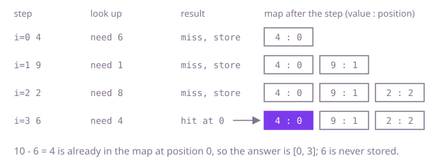

## The question

Given an array of integers and a target, find the two positions whose values add up to the target; exactly one such pair exists. Return both positions, smaller first.

What makes it harder than it looks: one value must never pair with itself (target 10 and a single 5 is not an answer), yet two equal values at different positions are a valid pair (`[3, 3]` with target 6). Negatives mean you cannot skip a value because it is already bigger than the target. And at 300,000 values, checking every pair is about 45 billion sums, far too slow.

## How to think about it

The first idea is to try every pair. That works, but look at what it repeats: for each value it scans the whole rest of the array asking "is my partner here?". The partner is not a mystery. For a value `x` it is exactly `target - x`. So the question for each value becomes "have I already seen `target - x`?", and a hash map from value to position answers that in constant time on average.

Walk Example 1, `nums = [4, 9, 2, 6]`, `target = 10`. At 4 I need 6: not seen, store 4 at 0. At 9 I need 1: not seen, store 9 at 1. At 2 I need 8: not seen, store 2 at 2. At 6 I need 4: seen at 0, so the answer is `[0, 3]`. The lookup comes before the store, so a value can only ever find an earlier position, never its own. That one ordering handles the self-pair trap and the equal-values case together: the second 3 finds the first.



## Brute force

Try every pair of positions `i < j`. It is correct because it checks every pair there is, so it cannot miss the one that adds up, and `j` starts after `i`, so a position never pairs with itself.

```java
static int[] indices(int[] nums, int target) {
    for (int i = 0; i < nums.length; i++) {
        for (int j = i + 1; j < nums.length; j++) { // j > i: never the same position
            if (nums[i] + nums[j] == target) {
                return new int[] {i, j};
            }
        }
    }
    return new int[0]; // unreachable when exactly one pair exists
}
```

**Complexity:** time O(n²), extra space O(1).

## Better: sort, then two pointers

Sorting lets you stop guessing. Put one pointer at the smallest value and one at the largest. If their sum is too small, the smallest value cannot pair with anything (the largest is already too small for it), so move the left pointer right. If the sum is too big, the largest value is useless, so move the right pointer left. Each step discards one value for good, so the pointers meet the pair. Sorting loses the original positions, so sort `(value, position)` pairs and read the positions back at the end.

```java
static int[] indices(int[] nums, int target) {
    int[][] pairs = new int[nums.length][];
    for (int i = 0; i < nums.length; i++) {
        pairs[i] = new int[] {nums[i], i}; // keep the original position with its value
    }
    Arrays.sort(pairs, (a, b) -> Integer.compare(a[0], b[0]));
    int lo = 0, hi = pairs.length - 1;
    while (lo < hi) { // lo < hi: never the same entry twice
        int sum = pairs[lo][0] + pairs[hi][0];
        if (sum == target) {
            int a = pairs[lo][1], b = pairs[hi][1];
            return new int[] {Math.min(a, b), Math.max(a, b)}; // sorting scrambled the order
        }
        if (sum < target) lo++; else hi--; // drop the value that cannot be in any pair
    }
    return new int[0];
}
```

**Complexity:** time O(n log n), extra space O(n) for the pairs.

**Prefer it when:** the input is already sorted, where you skip the sort and the pairs array and it runs in O(n) time and O(1) space. It also fits when the data can be reordered and you would rather keep a flat array than a hash map of boxed integers, or when you need every pair rather than one.

## Optimal: one pass with a hash map

Keep a map from each value seen so far to its position. For each value, look up `target - value` first; if it is there, the stored position and the current one are the answer. Only then store the current value. This is the reference solution.

```java
static int[] indices(int[] nums, int target) {
    Map<Integer, Integer> seen = new HashMap<>(); // value -> position, for values before this one
    for (int i = 0; i < nums.length; i++) {
        Integer partner = seen.get(target - nums[i]);
        if (partner != null) {
            return new int[] {partner, i}; // the earlier position is the smaller one
        }
        seen.put(nums[i], i); // stored after the lookup, so a value never pairs with itself
    }
    return new int[0];
}
```

**Complexity:** time O(n) on average, extra space O(n).

## Complexity

| Approach | Time | Extra space |
| --- | --- | --- |
| Brute force | O(n²) | O(1) |
| Better: sort, then two pointers | O(n log n) | O(n) |
| Optimal: one pass with a hash map | O(n) on average | O(n) |

## Where it shows up

No coding-round problem is linked to this question. The pattern, "remember what I have seen and look up the partner I need", turns up wherever two records must combine to a known total: matching two payments that together settle an invoice, pairing a debit with the credit that cancels it in a ledger, or picking two items in a basket that together hit a promotion threshold.

## Follow-up answers

**What changes if the array is sorted?** You no longer need the map. Put one pointer at each end; if the sum is too small move the left one right, if too big move the right one left. That is O(n) time and O(1) space, and the positions are the pointers themselves.

**What if several pairs add up to the target and you must return all of them?** Keep walking after a match instead of returning. With repeated values, store a list of positions per value, so a value that matches pairs with every earlier copy of its partner. The output itself can be large, so the cost is O(n plus the number of pairs).

**What if the numbers do not fit in memory?** Sort them externally and run the two-pointer pass over the sorted file, reading from both ends. Or split by a hash of the value so that `x` and `target - x` always land in the same partition (for example, partition on `min(x, target - x)`), then run the map version on each partition in memory.
