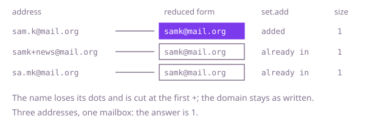

## The question

Given a list of email addresses, count how many different mailboxes they reach, where dots in the name are ignored, the first `+` in the name and everything after it up to the `@` is ignored, and the domain is compared exactly as written.

What makes it harder than it looks: the two rules apply to the name only, and a dot in the domain must stay, so `a.com` and `ac.om` are different places. The rules also interact: once the first `+` is reached, nothing after it matters, dots included. And with 100,000 addresses, comparing every address with every other is about five billion comparisons of strings up to 100 characters long.

## How to think about it

The first idea is to take the addresses one at a time, reduce each to a plain form, and look it up among the plain forms already seen. That is correct, but the lookup in a list is a scan, so each address pays for all the earlier ones.

What does that repeat? Two addresses are the same exactly when their plain forms are equal, and each address can be reduced on its own, without looking at any other. So the work splits in two: a function that turns one address into its plain form, and a structure that counts distinct plain forms. For the counting there are two natural tools. Sorting the plain forms puts equal ones next to each other, so a single pass counts the runs. A hash set answers "have I seen this before?" in constant time on average, and its size is the answer.

The plain form keeps the domain as written and cleans the name in one walk: stop at the first `+`, skip every `.` before it. Breaking out at the `+` is what makes dots after it never matter.

Walk Example 1, `["sam.k@mail.org", "samk+news@mail.org", "sa.mk@mail.org"]`. The first reduces to `samk@mail.org` (the dot goes) and is added to the set. The second reduces to `samk@mail.org` too (the label `+news` is cut), which is already in the set. The third reduces to `samk@mail.org` again. The set holds one entry, so the answer is 1.



## Brute force

Reduce each address to its plain form, and keep a list of the plain forms counted so far. Before adding a form, scan the list for it. It comes first because it follows the sentence directly, and it fixes the answer the faster versions must agree with. It is correct because a form is added exactly when no equal form is already in the list, so the list ends up holding each distinct form once.

```java
static int countDistinct(String[] emails) {
    List<String> seen = new ArrayList<>();
    for (String email : emails) {
        String plain = normalise(email);
        if (!seen.contains(plain)) { // a scan of every form counted so far
            seen.add(plain);
        }
    }
    return seen.size();
}

private static String normalise(String email) {
    int at = email.indexOf('@');
    StringBuilder name = new StringBuilder(at);
    for (int i = 0; i < at; i++) {
        char c = email.charAt(i);
        if (c == '+') break; // everything after the first plus is ignored
        if (c != '.') name.append(c);
    }
    return name.append(email, at, email.length()).toString(); // the domain is kept as written
}
```

**Complexity:** time O(m² × L) for m addresses of at most L characters, extra space O(total characters).

## Better: sort the reduced forms and count runs

This is a different tool: sorting puts equal reduced forms next to each other, so a form is new exactly when it differs from the one before it. Reduce every address, sort the array of reduced forms, and count the positions where the form changes.

```java
static int countDistinct(String[] emails) {
    String[] plain = new String[emails.length];
    for (int i = 0; i < emails.length; i++) {
        plain[i] = normalise(emails[i]);
    }
    Arrays.sort(plain); // equal forms end up next to each other
    int distinct = 0;
    for (int i = 0; i < plain.length; i++) {
        if (i == 0 || !plain[i].equals(plain[i - 1])) {
            distinct++; // the first of a run of equal forms
        }
    }
    return distinct;
}

private static String normalise(String email) {
    int at = email.indexOf('@');
    StringBuilder name = new StringBuilder(at);
    for (int i = 0; i < at; i++) {
        char c = email.charAt(i);
        if (c == '+') break; // everything after the first plus is ignored
        if (c != '.') name.append(c);
    }
    return name.append(email, at, email.length()).toString(); // the domain is kept as written
}
```

**Complexity:** time O(m log m × L) for m addresses of at most L characters, because the sort makes O(m log m) comparisons of up to L characters; extra space O(total characters).

**Prefer it when:** you want the equal addresses adjacent, for example to list the distinct mailboxes in order. The code as shown only counts, so listing them would be a one-line addition at the point where `distinct++` runs. For the count alone the hash set below is cheaper.

## Optimal: reduce each address, count distinct in a hash set

Reduce each address with the same function, add the result to a `HashSet`, and return the set's size. Each address is touched once, and the set tells in one step whether a form is already known. This is the reference solution.

```java
static int countDistinct(String[] emails) {
    Set<String> mailboxes = new HashSet<>();
    for (String email : emails) {
        mailboxes.add(normalise(email));
    }
    return mailboxes.size();
}

private static String normalise(String email) {
    int at = email.indexOf('@');
    StringBuilder name = new StringBuilder(at);
    for (int i = 0; i < at; i++) {
        char c = email.charAt(i);
        if (c == '+') break; // everything after the first plus is ignored
        if (c != '.') name.append(c);
    }
    return name.append(email, at, email.length()).toString(); // the domain is kept as written
}
```

Strings are immutable, so the cleaned name is a new value that must be kept: calling `replace` and dropping the result changes nothing.

**Complexity:** time O(total characters) on average, O(m log m × L) in the worst case (Java's `HashMap` turns a crowded bucket of `String` keys into a tree, and each comparison reads up to L characters), extra space O(total characters).

## Complexity

| Approach | Time | Extra space |
| --- | --- | --- |
| Brute force | O(m² × L) | O(total characters) |
| Better: sort, then count runs | O(m log m × L) | O(total characters) |
| Optimal: hash set | O(total characters) average, O(m log m × L) worst | O(total characters) |

Here m is the number of addresses and L the longest address, at most 100 characters.

## Where it shows up

`playlist-dedupe` uses the same shape for songs. `Track.songKey()` calls `SongKey.of`, which normalises the title and the artist (trimmed, lower case, single spaces, a trailing "(...remaster...)" removed) and joins them into one key. `PlaylistTools.dedupe` then keeps a track only when `seen.add(key)` on a `HashSet` returns true, so the first occurrence stays, and `similarity` builds a set of keys per playlist the same way. Here the rules are about dots and labels in a name; there they are about case, spacing and a remaster suffix, but the move is the same: reduce each item on its own, then let a set decide whether it was seen.

Outside the coding round, the same reduction is used to merge duplicate customer records, to count unique visitors from addresses spelled in different ways, and to stop one person from signing up twice with tagged variants of one mailbox.

## Follow-up answers

**How would you return the groups of addresses that reach the same mailbox?** Use a map from the reduced form to a list of the original addresses instead of a set. The groups are the values of the map, and its size is the count.

**What if a new rule is added, such as ignoring case in the name?** Add it to `normalise` and nothing else changes, which is the point of reducing each address on its own. Only the rule needs care: lower-casing the domain is safe, while lower-casing the name is a decision about the provider.

**What if the list is too large to keep every reduced address in memory?** Store a 64-bit hash of each reduced form in the set instead of the text, accepting a tiny chance of two mailboxes colliding, or sort the reduced forms on disk and count the distinct ones in one pass over the sorted file, as in the Better section.
