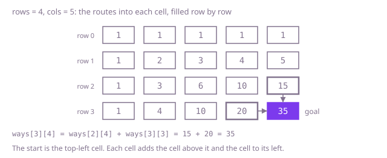

## The question

A parcel crosses a grid of `rows` by `cols` cells from the top-left cell to the bottom-right one, and every move goes one cell right or one cell down. Count the different routes it can take.

What makes it harder than it looks is how fast the count grows. Every route is short, at most 198 moves here, but a 16 by 20 floor already has 1,855,967,520 of them, so anything that walks the routes one at a time is out. A floor of one cell has one route, the empty one, not zero. And if you know the closed form, its running product passes the `int` range long before the answer does.

## How to think about it

The first idea is to follow the parcel: from each cell try a move down and a move right, and count the walks that reach the goal. It is correct, but it repeats itself. The number of routes from a cell to the goal does not depend on how the parcel got there, yet the search works it out again for every way of arriving. On the 16 by 20 floor it counts almost two billion routes one at a time.

So count per cell instead of per route. A route into a cell arrives from the cell above it or from the cell to its left, never both, so the cell's count is the sum of those two counts. The top row and the left column have one route each, straight along the edge. Fill the counts row by row and every cell finds its two counts already filled. A row only needs the row above it, so one array of counts per column is enough: before the update, `ways[c]` still holds the count for the cell above, and adding `ways[c - 1]`, already updated for this row, adds the routes from the left.

Walk Example 1, `rows = 4`, `cols = 5`. Row 0 is all 1s. Row 1 adds the left neighbour each time: 1, 2, 3, 4, 5. Row 2: 1, 3, 6, 10, 15. Row 3: 1, 4, 10, 20, 35. The goal has 35 routes, 15 arriving from above and 20 from the left. Every count is the count for a cell on the way to the goal, and those only grow towards the goal, so none of them is larger than the answer and none can overflow.



## Brute force

Follow the parcel from the start: move down first and count the routes from there, move right first and count those, and add. It comes first because it is the question written as code, and it fixes the answers the faster versions must match. It is correct because every route's first move is either down or right, the two groups share no route, and from a cell on the last row or column exactly one route is left, straight on.

```java
static int routes(int rows, int cols) {
    return from(0, 0, rows, cols);
}

/** Routes from cell (r, c) to the bottom-right cell. */
private static int from(int r, int c, int rows, int cols) {
    if (r == rows - 1 || c == cols - 1) {
        return 1; // on the last row or column one straight run is left
    }
    return from(r + 1, c, rows, cols) + from(r, c + 1, rows, cols); // move down first, or right first
}
```

**Complexity:** time proportional to the number of routes, about two calls per route, close to 4 × 10^9 calls at the largest counts allowed; extra space O(rows + cols) for the recursion, at most 198 deep, which fits in the stack.

## Better: a table of counts per cell

Keep the count for every cell in a table and fill it row by row: 1 along the top row and the left column, and above plus left everywhere else.

```java
static int routes(int rows, int cols) {
    int[][] ways = new int[rows][cols]; // ways[r][c]: routes from the top-left cell into cell (r, c)
    for (int r = 0; r < rows; r++) {
        for (int c = 0; c < cols; c++) {
            if (r == 0 || c == 0) {
                ways[r][c] = 1; // along the top row or down the left column: one straight run
            } else {
                ways[r][c] = ways[r - 1][c] + ways[r][c - 1]; // arrive from above or from the left
            }
        }
    }
    return ways[rows - 1][cols - 1];
}
```

**Complexity:** time O(rows × cols), extra space O(rows × cols).

**Prefer it when:** you need the counts for other cells too. The floor looks the same turned half a turn, so the routes from cell `(r, c)` to the goal number `ways[rows - 1 - r][cols - 1 - c]`, and the routes that pass through `(r, c)` are `ways[r][c]` times that.

## Optimal: one row of counts

Keep only the counts for the current row. For each new row, add each cell's left neighbour into it, left to right: the old value is the routes from above and the neighbour, already updated, is the routes from the left. This is the reference solution. The count also has a closed form, a binomial coefficient, which needs no table at all; the follow-up answers show it. That closed form is faster still, O(min(rows, cols)) time and O(1) extra space. The table is kept as the answer here because it is what carries over to blocked cells and other moves, as the follow-up answers show too.

```java
static int routes(int rows, int cols) {
    int[] ways = new int[cols]; // ways[c]: routes into column c of the row being filled
    Arrays.fill(ways, 1); // the top row: only moves to the right reach it
    for (int r = 1; r < rows; r++) {
        for (int c = 1; c < cols; c++) {
            ways[c] += ways[c - 1]; // the old ways[c] counts routes from above, ways[c - 1] from the left
        }
    }
    return ways[cols - 1];
}
```

**Complexity:** time O(rows × cols), extra space O(cols). Passing the shorter side as the row length makes the extra space O(min(rows, cols)); the time stays O(rows × cols), and the count is the same with the floor turned on its side.

## Complexity

| Approach | Time | Extra space |
| --- | --- | --- |
| Brute force | proportional to the number of routes, up to about 4 × 10^9 calls | O(rows + cols) recursion, at most 198 deep |
| Better: a table of counts per cell | O(rows × cols) | O(rows × cols) |
| Optimal: one row of counts | O(rows × cols) | O(cols) |

## Where it shows up

Counting the ways to merge two ordered queues so that each keeps its own order has exactly this shape: a move down takes the next item from one queue and a move right from the other. So does counting the shortest walks between two corners of a street grid. The same table with costs instead of counts finds the cheapest route across a grid, and it is the shape of the alignment tables behind diff tools and edit distance.

## Follow-up answers

**What if some cells were blocked?** Give a blocked cell a count of 0 and fill the rest as before. The top row and the left column are then no longer all 1s: a blocked cell cuts off every cell after it on that edge, so fill the edges with the same above-plus-left rule, treating cells off the floor as 0. The cost stays O(rows × cols) time and O(cols) space.

**Can you count the routes in O(min(rows, cols)) time?** Every route is an order of `rows - 1` moves down and `cols - 1` moves right, so the count is the binomial coefficient C(rows + cols − 2, k) with k = min(rows, cols) − 1. Build it as a running product: for i from 1 to k, multiply by (rows + cols − 2 − k + i), then divide by i. After each step the value is itself a binomial coefficient, so the division is exact. Do it in a `long`: just before the last division the product is k times the answer, which is far past the `int` range on the 16 by 20 floor.

**What if the parcel could also move one cell diagonally, down and to the right at once?** Then a cell is also entered from the cell up and to its left, so its count is above plus left plus that diagonal. With one row, save each cell's old value in a variable before overwriting it, because that old value is the diagonal for the next cell to the right. These counts grow faster, so the largest floor whose count fits an `int` is smaller.
