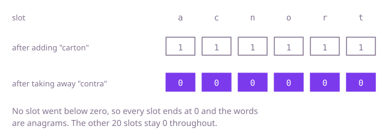

## The question

Given two words, say whether one can be rearranged into the other. Every letter has to be used, and used exactly as often as it appears.

What makes it harder than it looks is that the obvious checks are not enough. "Same length" is not enough, and "same set of letters" is not enough either: `noon` and `nnno` have the same length and the same letters, but different counts. And at 200,000 letters, matching letters one at a time against the other word is far too slow.

## How to think about it

Start with how you would do it by hand: take each letter of the first word and cross out an equal letter in the second. If you ever cannot find one, the answer is no. That is correct, but every letter rescans the second word. What the scan is really looking for is a count, how many of this letter are left, so the answer should not depend on positions at all. Sorting both words puts equal letters side by side and makes position irrelevant: anagrams sort to the same string. Better still, positions never need to be ordered, only counted, and with 26 possible letters the counts fit in a table of 26 numbers.

Walk Example 1, `carton` and `contra`. The lengths are both 6. Adding the letters of `carton` sets the slots for `c`, `a`, `r`, `t`, `o` and `n` to 1. Taking away the letters of `contra` brings `c`, `o`, `n`, `t`, `r` and `a` back to 0, and no slot ever dips below 0. Equal lengths plus no dip means every slot ends at exactly 0, so the answer is `true`. On `noon` and `nnno` the third `n` of the second word would take the `n` slot from 2 to -1, which is the signal for `false`.



## Brute force

For each letter of `a`, find an equal letter in `b` that is not already matched, and mark it matched. It is what you do by hand, and it fixes the answer to compare against. It is correct because the lengths are equal and every letter of `a` claims its own distinct letter of `b`; if all of them succeed, every letter of `b` was claimed too.

```java
static boolean areAnagrams(String a, String b) {
    if (a.length() != b.length()) {
        return false; // different lengths can never use the same letters
    }
    boolean[] used = new boolean[b.length()]; // letters of b already matched
    for (int i = 0; i < a.length(); i++) {
        boolean found = false;
        for (int j = 0; j < b.length() && !found; j++) {
            if (!used[j] && b.charAt(j) == a.charAt(i)) {
                used[j] = true; // each letter of b can be claimed once
                found = true;
            }
        }
        if (!found) {
            return false; // a has a letter b cannot supply
        }
    }
    return true;
}
```

**Complexity:** time O(n²), extra space O(n) for the `used` flags.

## Better: sort both and compare

Anagrams are the same letters in a different order, so sorting removes the difference. Sort a copy of each word's letters and compare them.

```java
static boolean areAnagrams(String a, String b) {
    char[] x = a.toCharArray();
    char[] y = b.toCharArray();
    Arrays.sort(x); // anagrams sort to the same sequence
    Arrays.sort(y);
    return Arrays.equals(x, y); // also false when the lengths differ
}
```

**Complexity:** time O(n log n), extra space O(n) for the two char arrays.

**Prefer it when:** the text is not limited to 26 lowercase letters. This code never indexes a table by letter, so it works unchanged for uppercase, digits, accents or any other `char`. (It compares `char` units, so letters outside the basic plane need the code-point care in the follow-up.)

## Optimal: count the letters in a table

Keep a table of 26 counts. Add one for every letter of `a`, take one away for every letter of `b`, and stop the moment a count would go below zero. This is the reference solution.

```java
static boolean areAnagrams(String a, String b) {
    if (a.length() != b.length()) {
        return false; // different lengths can never use the same letters
    }
    int[] counts = new int[26]; // how many of each letter a has not yet been matched by b
    for (int i = 0; i < a.length(); i++) {
        counts[a.charAt(i) - 'a']++;
    }
    for (int i = 0; i < b.length(); i++) {
        if (--counts[b.charAt(i) - 'a'] < 0) {
            return false; // b uses a letter more often than a does
        }
    }
    return true; // equal lengths and no overdraw: every count is back to zero
}
```

**Complexity:** time O(n), extra space O(1), because the table has 26 slots whatever the input length.

## Complexity

| Approach | Time | Extra space |
| --- | --- | --- |
| Brute force | O(n²) | O(n) |
| Better: sort both and compare | O(n log n) | O(n) |
| Optimal: count the letters in a table | O(n) | O(1), the table has 26 slots |

## Where it shows up

Counting how often each key occurs, then comparing two tallies, is the everyday use of a hash map. A search index compares word counts to spot near-duplicate documents, and a test helper checks that two lists hold the same items in any order by comparing their tallies.

## Follow-up answers

**What changes if the text can contain any Unicode character, not just lowercase letters?** The fixed table of 26 no longer fits, so I would use a hash map from character to count, with the same add-then-subtract logic. Characters outside the basic plane are two `char` values in Java, so I would count code points instead.

**How would you group a long list of words into sets of anagrams?** Give every word a key that is identical for all its anagrams, such as its letters sorted or its 26 counts joined into a string, and put words with the same key in one list in a hash map.

**Can you do it with one pass over each string?** Yes, that is what the counting does: one pass over `a` to add, one over `b` to subtract. It cannot be a single combined pass in general, because the letter of `b` at a given position may only be supplied by a later letter of `a`.
