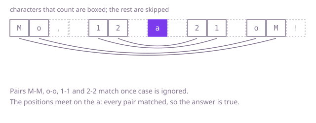

## The question

Given a string, say whether it reads the same forwards and backwards once case is ignored and everything that is not a letter or a digit is dropped. An empty result counts as a palindrome.

What makes it harder than it looks is the ignoring. Digits are compared, not dropped, so `kayak7` fails. Punctuation can sit at either end or in long runs in the middle, and a string made only of punctuation has nothing to compare at all. With half a million characters, the code also has to stay linear and avoid building big strings it does not need.

## How to think about it

The first idea is the one you would do on paper: write the text again with only letters and digits in lower case, write it backwards, and see whether the two match. That is correct and already linear. What it repeats is work on characters you never needed to look at twice: it builds a cleaned copy and a reversed copy just to compare a string with itself. A palindrome only asks whether the first counting character matches the last, the second matches the second last, and so on, so two positions walking in from the ends can answer that directly. Skipping the ignored characters in place removes the copies altogether.

Walk Example 1, `s = "Mo, 12 a 21 oM!"`. The left position starts on `M` and the right position on `!`, which does not count, so the right one steps in to `M`. The two `M` match once case is ignored. Then `o` and `o`. Next the left position meets `,` and a space and steps past them, and the right one steps past a space, so `1` meets `1`, then `2` meets `2`. The positions are now on the same `a`, they have met, and every pair matched: `true`.



## Brute force

Build the cleaned text, reverse it and compare. It is what you say first, and it fixes the answer every faster version must agree with. It is correct because a string is a palindrome exactly when it equals its reverse, and the cleaning keeps precisely the characters that count, in order.

```java
static boolean isPalindrome(String s) {
    StringBuilder cleaned = new StringBuilder();
    for (char c : s.toCharArray()) {
        if (Character.isLetterOrDigit(c)) { // digits stay: they are compared
            cleaned.append(Character.toLowerCase(c));
        }
    }
    String forwards = cleaned.toString();
    String backwards = cleaned.reverse().toString(); // reverse() works in place on the builder
    return forwards.equals(backwards);
}
```

**Complexity:** time O(n), extra space O(n) for the cleaned text and its reverse.

## Better: clean once, compare from both ends

Keep the cleaned copy but drop the reversed one. Two indexes walk the cleaned text inwards and compare character with character, so the comparison stops at the first mismatch and only one extra string exists.

```java
static boolean isPalindrome(String s) {
    StringBuilder cleaned = new StringBuilder();
    for (char c : s.toCharArray()) {
        if (Character.isLetterOrDigit(c)) {
            cleaned.append(Character.toLowerCase(c));
        }
    }
    int left = 0;
    int right = cleaned.length() - 1;
    while (left < right) { // an empty or one-character text never enters the loop
        if (cleaned.charAt(left) != cleaned.charAt(right)) {
            return false;
        }
        left++;
        right--;
    }
    return true;
}
```

**Complexity:** time O(n), extra space O(n) for the cleaned text.

**Prefer it when:** you want the cleaning and the comparing as two separate steps that are easy to test on their own, or you will reuse the cleaned text for something else. For a single yes or no it still pays for a copy that the next version avoids.

## Optimal: two positions on the original text

Skip the copy. Keep one position at each end and move them towards each other, one step per loop iteration. If the left position is on a character that does not count, move it in. Otherwise, if the right one is on a character that does not count, move it in. Otherwise both point at characters that count, so compare them ignoring case: a difference is the answer `false`, and a match moves both positions in. There are no inner skip loops. The test `left < right` is checked again before every step, so a text with nothing that counts, like `" .,; "`, ends with the positions meeting and the answer `true`. This is the reference solution.

```java
static boolean isPalindrome(String s) {
    int left = 0;
    int right = s.length() - 1;
    while (left < right) {
        if (!Character.isLetterOrDigit(s.charAt(left))) {
            left++; // ignore this character on the left
        } else if (!Character.isLetterOrDigit(s.charAt(right))) {
            right--; // ignore this one on the right
        } else if (Character.toLowerCase(s.charAt(left)) != Character.toLowerCase(s.charAt(right))) {
            return false; // a pair that counts and differs
        } else {
            left++;
            right--;
        }
    }
    return true; // the positions met: every pair matched
}
```

**Complexity:** time O(n), extra space O(1).

## Complexity

| Approach | Time | Extra space |
| --- | --- | --- |
| Brute force | O(n) | O(n) |
| Better: clean once, compare from both ends | O(n) | O(n) |
| Optimal: two positions on the original text | O(n) | O(1) |

## Where it shows up

No coding-round problem is linked to this question. Walking in from both ends is how symmetric structures are checked in place: matching the opening and closing markers of a record, or checking that a sequence reads the same in both directions. Skipping characters that do not count before comparing is also the usual way to normalise user input, such as ignoring punctuation and case when two usernames or search terms are compared.

## Follow-up answers

**How would you allow deleting at most one character to make it a palindrome?** On the first mismatch, try skipping the left character and try skipping the right one, and check whether either of the remaining middle parts is a palindrome with the same two-position walk. If neither is, the answer is no.

**What changes if the text can contain accented letters and other Unicode?** Normalise the text first so that an accented letter has one form, and compare code points, not `char` values, because some characters take two `char` values in Java. The two-position walk stays the same.

**How would you find the longest palindrome inside a string?** Treat every position, and every gap between two positions, as a centre and expand outwards while the two sides match. Keep the longest. That is O(n²) in the worst case.
