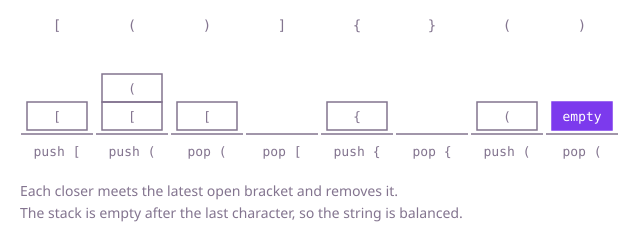

## The question

A string contains only round, square and curly brackets. Say whether every opening bracket is closed by a bracket of the same kind, with pairs nested properly: the most recently opened bracket must close first.

What makes it harder than it looks: counting brackets of each kind is not enough, because a crossed pair like `"[{]}"` has equal counts and is still wrong. A closing bracket can arrive with nothing open, and an opening bracket can be left open at the end, so both ends need a check. And at 400,000 characters, the nesting can be hundreds of thousands deep, which matters for anything recursive.

## How to think about it

The first idea is to repeatedly delete adjacent matching pairs, `()`, `[]` and `{}`; if the string shrinks to nothing it was balanced. That is correct, but each pass rescans the whole string, and a string nested 200,000 deep needs 200,000 passes. Look at what the deletions are doing: the innermost pair is the first to disappear, so the order of matching is last opened, first closed. That is a stack. Instead of deleting, keep the openers that are still waiting, with the newest on top; a closer either matches the top, or the string is wrong.

Walk Example 1, `s = "[()]{}()"`. Read `[`: push. Read `(`: push, the stack is `[` `(`. Read `)`: the top is `(`, a match, pop. Read `]`: the top is `[`, pop, the stack is empty. Read `{`, then `}`: push, then pop. Read `(`, then `)`: push, then pop. The string ends with the stack empty, so it is balanced. In `"[{]}"` the `]` meets a `{` on top, a mismatch, and the answer is `false` straight away.



## Brute force

Delete every adjacent `()`, `[]` and `{}` pair, and repeat until a pass removes nothing. It is what you say first, and it fixes the answer every faster version must agree with. It is correct because a balanced string always contains an adjacent matched pair (its innermost one), and removing it leaves a balanced string, so a balanced string shrinks to empty; a string that is not balanced gets stuck on something non-empty.

```java
static boolean isBalanced(String s) {
    String current = s;
    while (true) {
        String next = current.replace("()", "").replace("[]", "").replace("{}", "");
        if (next.length() == current.length()) {
            return current.isEmpty(); // nothing left to remove: balanced only if nothing is left
        }
        current = next;
    }
}
```

**Complexity:** time O(n²) in the worst case (a string nested n/2 deep loses one level per pass, and each pass costs O(n)), extra space O(n) for the new string of each pass.

## Better: recursive descent

Read the string the way its grammar is written: a sequence of groups, where each group is an opener, a sequence of groups, and the matching closer. A function reads groups from a position and returns where it stopped; for each opener it calls itself for the contents and then checks for the right closer. The string is balanced if the function consumes all of it.

```java
static boolean isBalanced(String s) {
    return skipGroups(s, 0) == s.length(); // -1 (a broken group) never equals the length
}

/** Reads balanced groups from position i; returns where it stopped, or -1 if a group is broken. */
private static int skipGroups(String s, int i) {
    while (i < s.length() && isOpener(s.charAt(i))) {
        char opener = s.charAt(i);
        i = skipGroups(s, i + 1); // the contents of this group
        if (i < 0 || i >= s.length() || s.charAt(i) != closerFor(opener)) {
            return -1; // broken group, or the string ended inside it
        }
        i++; // step past the closer
    }
    return i; // stopped at a closer for the caller to check, or at the end
}

private static boolean isOpener(char c) {
    return c == '(' || c == '[' || c == '{';
}

private static char closerFor(char opener) {
    return opener == '(' ? ')' : opener == '[' ? ']' : '}';
}
```

**Complexity:** time O(n), extra space O(d) for the call stack, where d is the nesting depth, up to n/2.

**Prefer it when:** the nesting is known to be shallow and you want the structure itself, for example to build a tree of the groups: the calls mirror the groups one to one. It is the wrong choice for this question's input sizes, because Java's call stack holds only a few thousand to some tens of thousands of frames, and a string nested 200,000 deep makes it fail with a stack overflow.

## Optimal: a stack of open brackets

Push each opener onto a stack. For a closer, fail if the stack is empty (nothing to close) or the top is a different kind; otherwise pop. At the end the string is balanced only if the stack is empty. Keeping the stack in an array of the string's length avoids the call-stack limit and the cost of boxing. This is the reference solution.

```java
static boolean isBalanced(String s) {
    char[] stack = new char[s.length()]; // the openers still waiting, latest on top
    int top = 0;
    for (int i = 0; i < s.length(); i++) {
        char c = s.charAt(i);
        if (c == '(' || c == '[' || c == '{') {
            stack[top++] = c;
        } else {
            if (top == 0) {
                return false; // a closer with nothing open
            }
            char opener = stack[--top];
            if (!matches(opener, c)) {
                return false; // wrong kind, or crossed pairs
            }
        }
    }
    return top == 0; // anything left over was never closed
}

private static boolean matches(char opener, char closer) {
    return (opener == '(' && closer == ')')
            || (opener == '[' && closer == ']')
            || (opener == '{' && closer == '}');
}
```

**Complexity:** time O(n), extra space O(n) (the stack can hold every opener).

## Complexity

| Approach | Time | Extra space |
| --- | --- | --- |
| Brute force | O(n²) | O(n) |
| Better: recursive descent | O(n) | O(d) call stack, up to O(n) |
| Optimal: a stack of open brackets | O(n) | O(n) |

## Where it shows up

`build-log-bracket-checker` is this question on build-log lines: its `firstError` keeps a stack of the columns of open brackets in an `int` array, which is the same array-as-stack as the reference here. A closer with the stack empty is reported as an unexpected closer, a closer that meets the wrong kind as a mismatch, and brackets still open at the end as unclosed, reported at the bottom of the stack because that is the earliest one still open. It also skips brackets inside quoted strings, which this question does not have. Real-world uses: the matching-bracket highlight in an editor, and the checks in JSON, XML and expression parsers that must reject input whose nesting is broken.

## Follow-up answers

**How would you report the position of the first mistake?** Push the position of each opener instead of the character; the character is `s.charAt(position)`. A closer with an empty stack, or one that meets the wrong kind, is a mistake at that closer's own position, and you stop there. If the scan ends with openers still on the stack, the one at the bottom is the earliest opener that never found its closer, which is where the damage begins.

**What if the text also contains other characters that should be ignored?** Skip any character that is not one of the six brackets before the push-or-pop branch. If brackets inside quoted strings or comments must be ignored too, add a small state for "inside a quote" that switches on the quote character and off at the closing one, and skip brackets while it is on.

**What if the string is too large to hold in memory?** Read it in chunks, one character at a time from a stream. Only the stack grows, and it holds the openers still waiting, so memory is proportional to the deepest nesting, not to the length.
