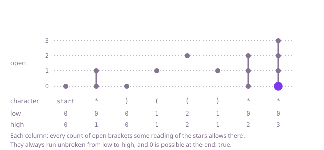

## The question

Each star in a string of round brackets may be read as `(`, as `)` or as nothing. Return whether some reading of the stars makes the brackets balance.

What makes it harder than it looks is that the stars interact. Reading every star the same way fails: Example 1 needs one star as `(`, one as `)` and one as nothing. A single left-to-right count that lets a star stand in for a missing `(` misses that a star cannot close a bracket opened after it: Example 2 has as many stars as `(`, but the first star comes too early. Trying all three readings of every star is 3^k work for k stars, and at 100,000 characters even a table that is quadratic in the length is too slow.

## How to think about it

The first idea is to try every reading of the stars, keeping a count of the brackets left open and abandoning a reading the moment a `)` has nothing to close. It is correct, but it branches three ways at every star. What it repeats is this: after a prefix, the only thing that matters about a reading is how many brackets it leaves open, because two readings with the same count behave the same from there on. So keep, for each prefix, the set of counts some reading can leave. That is a table over positions and counts, O(n²).

The step to the greedy is the shape of that set: it is always an unbroken range, every whole number from some `low` to some `high`. It starts as {0}. A `(` moves every count up by one, a `)` moves every count down by one and drops a count that would go below zero, and a star turns each count k into k - 1, k and k + 1, again dropping -1. Each of these turns an unbroken range into an unbroken range: from `low + 1` to `high + 1`, from `low - 1` to `high - 1`, or from `low - 1` to `high + 1`, cut off at zero. So two numbers describe the whole set. `high` is the count when every star so far is read as `(`; if it drops below zero, even that reading has more `)` than `(`, the set is empty and the answer is false. `low` reads every star as `)`, except that it never goes below zero, which is exactly the rule a single count was missing: a star can only close a bracket that is already open. At the end the brackets balance when 0 is in the set, that is, when `low` is 0. Tracking only the two ends is safe because every count between them is reachable by some reading: the range invariant above.

Walk Example 1, `s = "*)(()**"`, writing the range as low to high. It starts at 0 to 0. The star makes it 0 to 1, the `)` 0 to 0, the two `(` 1 to 1 and then 2 to 2, the `)` 1 to 1, and the last two stars 0 to 2 and 0 to 3. `low` is 0 at the end, so the answer is true. In Example 2, `"*((*"`, the range goes 0 to 1, 1 to 2, 2 to 3 and 1 to 4: `low` ends at 1, so false. In Example 3, `")**"`, `high` is -1 after the first character: false at once.



## Brute force

Read the string from the left with a count of open brackets, and at each star try it as `(`, as `)` and as nothing. A reading fails as soon as the count goes below zero, and succeeds if the count is zero at the end. It comes first because it is the rule written as code, and it fixes the answers to compare against. It is correct because it tries every reading of the stars and checks each one exactly by the rule.

```java
static boolean canBalance(String s) {
    return balances(s, 0, 0);
}

/** Whether s from position i on can balance with open brackets still waiting to be closed. */
private static boolean balances(String s, int i, int open) {
    if (open < 0) {
        return false; // a ) closed nothing
    }
    if (i == s.length()) {
        return open == 0;
    }
    char c = s.charAt(i);
    if (c == '(') {
        return balances(s, i + 1, open + 1);
    }
    if (c == ')') {
        return balances(s, i + 1, open - 1);
    }
    return balances(s, i + 1, open + 1) // the star as (
            || balances(s, i + 1, open - 1) // as )
            || balances(s, i + 1, open); // as nothing
}
```

**Complexity:** time O(3^k) for k stars, up to O(3^n); extra space O(n) for the recursion, one call per character, which overflows the stack on long strings.

## Better: the set of possible counts

Keep a flag for every count of open brackets, saying whether some reading of the prefix leaves exactly that many, and update all the flags at each character. After i characters at most i brackets are open, so each step looks at i + 1 counts.

```java
static boolean canBalance(String s) {
    int n = s.length();
    boolean[] can = new boolean[n + 2]; // can[k]: some reading so far leaves exactly k open
    boolean[] next = new boolean[n + 2];
    can[0] = true;
    for (int i = 0; i < n; i++) {
        char c = s.charAt(i);
        Arrays.fill(next, 0, i + 2, false);
        for (int k = 0; k <= i; k++) { // after i characters at most i brackets are open
            if (can[k]) {
                if (c != ')') {
                    next[k + 1] = true; // a ( or a star read as (
                }
                if (c != '(' && k > 0) {
                    next[k - 1] = true; // a ) or a star read as ), with a bracket to close
                }
                if (c == '*') {
                    next[k] = true; // a star read as nothing
                }
            }
        }
        boolean[] swap = can;
        can = next;
        next = swap;
    }
    return can[0];
}
```

**Complexity:** time O(n²), extra space O(n).

**Prefer it when:** you need more than yes or no: the table holds every count of open brackets each prefix can leave, and with numbers in place of the flags it counts the readings of the stars that balance.

## Optimal: the range of possible counts

Keep only `low` and `high`, the fewest and the most brackets that can be open. A `(` raises both, a `)` lowers both, and a star lowers `low` and raises `high`. Stop with false when `high` drops below zero, never let `low` drop below zero, and answer whether `low` is 0 at the end. This is the reference solution.

```java
static boolean canBalance(String s) {
    int low = 0; // fewest brackets that can be open here
    int high = 0; // most brackets that can be open here
    for (int i = 0; i < s.length(); i++) {
        char c = s.charAt(i);
        low += c == '(' ? 1 : -1; // the fewest read a star as )
        high += c == ')' ? -1 : 1; // the most read a star as (
        if (high < 0) {
            return false; // more ) than ( and stars together: no reading survives
        }
        low = Math.max(low, 0); // a count below zero closed nothing: drop those readings
    }
    return low == 0;
}
```

**Complexity:** time O(n), extra space O(1).

## Complexity

| Approach | Time | Extra space |
| --- | --- | --- |
| Brute force | O(3^k) for k stars, up to O(3^n) | O(n) recursion, overflows on long strings |
| Better: the set of possible counts | O(n²) | O(n) |
| Optimal: the range of possible counts | O(n) | O(1) |

## Where it shows up

Checking input that is not yet fully known: an editor deciding whether a half-typed expression with placeholders can still be completed to balanced brackets, or a template whose slots may expand to an opening tag, a closing tag or nothing. The range trick itself, keeping only the smallest and largest value a quantity can take over every choice, works whenever the possible values stay an unbroken range, such as the possible length of a queue or the possible stock level when some events in a log are uncertain.

## Follow-up answers

**What if you also had to say what each star stands for?** Keep the positions of the `(` still open and of the stars not yet used in two stacks. A `)` closes the latest open `(` if there is one, and otherwise the latest star, which then stands for `(`; with neither, the answer is false. At the end, pair the open `(` and the stars from the top of both stacks: each `(` needs a star after it, which then stands for `)`, and if the star on top comes before the `(` on top the answer is false. Every star still unused stands for nothing. That is O(n) time and O(n) extra space.

**What if a star had to stand for a bracket and could not stand for nothing?** Every count after i characters then has the same parity as i, so the possible counts are every other number from `low` to `high`. The bounds move as before, but where `low` would drop to -1 it becomes 1, the smallest count of the right parity. The answer is still whether `low` ends at 0, which also rules out strings of odd length.

**What if there were square and curly brackets as well, and a star could stand for any bracket?** A count is no longer enough, because a closer must match the kind of the bracket it closes, so the state would be the whole stack of open kinds. An interval table works instead: a stretch balances if it is empty, if its first character is a star read as nothing and the rest balances, or if its first character, an opener or a star, can be paired with a later character that closes it, with both the part between them and the part after balancing. That is O(n³) time and O(n²) space.
