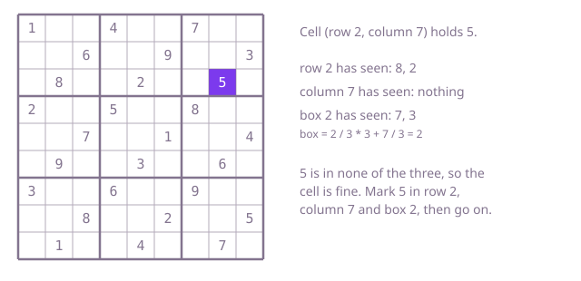

## The question

Given a partly filled 9 by 9 sudoku board, say whether any digit appears twice in the same row, the same column or the same 3 by 3 box. Only the digits already placed are checked; the board does not have to be solvable.

What makes it harder than it looks is the box. Rows and columns come straight from the indexes, but a cell's box has to be computed, and a wrong formula passes every test that has a repeat in a row or a column. Two 5s in different rows and different columns can still collide in a box, as in Example 3. The board is also a fixed size, so there is no large input to hurt you; the work is in getting the bookkeeping right.

## How to think about it

The first idea is to take every digit and compare it with every other cell, asking "do we share a row, a column or a box, and do we hold the same digit?". That is correct and needs no structure, but most comparisons are with cells that share nothing. The question is really about groups: 9 rows, 9 columns and 9 boxes, 27 groups, each of which may hold a digit once. So go group by group, and in each one remember the digits seen so far. Better still, visit each cell once and have all 27 records ready, so a cell checks its own row, its own column and its own box and then marks the digit in all three.

Walk Example 1 and stop at the cell in row 2, column 7, which holds 5. The cells before it in reading order have filled the records: row 2 has seen 8 and 2, column 7 has seen nothing, and box 2 has seen 7 and 3. The box number is `row / 3 * 3 + column / 3 = 2 / 3 * 3 + 7 / 3 = 0 + 2 = 2`. The digit 5 is in none of the three records, so it is fine, and it is marked in all three. The walk reaches the end without a repeat, so the answer is `true`. In Example 3 the second 5 is at row 1, column 1, whose box is `1 / 3 * 3 + 1 / 3 = 0`, the same box as the first 5 at row 0, column 0, so the box record already holds 5 and the answer is `false`.



## Brute force

For every cell that holds a digit, compare it with every other cell: if the other cell shares the row, the column or the box and holds the same digit, the board is invalid. It is correct because it checks every pair of cells against the three rules, with no state to get wrong.

```java
static boolean isValid(String[] rows) {
    for (int r1 = 0; r1 < 9; r1++) {
        for (int c1 = 0; c1 < 9; c1++) {
            char digit = rows[r1].charAt(c1);
            if (digit == '.') {
                continue; // empty cells break no rule
            }
            for (int r2 = 0; r2 < 9; r2++) {
                for (int c2 = 0; c2 < 9; c2++) {
                    if (r1 == r2 && c1 == c2) {
                        continue; // a cell never conflicts with itself
                    }
                    boolean sameBox = r1 / 3 == r2 / 3 && c1 / 3 == c2 / 3;
                    if ((r1 == r2 || c1 == c2 || sameBox) && rows[r2].charAt(c2) == digit) {
                        return false; // same digit in a shared row, column or box
                    }
                }
            }
        }
    }
    return true;
}
```

**Complexity:** the board has a fixed 81 cells, so this is constant, O(1): at most 81 × 80 = 6,480 comparisons, and extra space O(1). On an N by N board it would be O(N⁴).

## Better: check one group at a time with a bitmask

Go through the 9 rows, the 9 columns and the 9 boxes, and in each group scan its 9 cells with a small integer whose bit `d` says digit `d` was seen. For group number `g` and cell number `k`, the row cell is `(g, k)`, the column cell is `(k, g)` and the box cell is `(g / 3 * 3 + k / 3, g % 3 * 3 + k % 3)`. The three scans share one loop here, but each group has its own mask.

```java
static boolean isValid(String[] rows) {
    for (int g = 0; g < 9; g++) {
        int[] seen = new int[3]; // bit d: digit d seen in row g, column g, box g
        for (int k = 0; k < 9; k++) {
            if (repeats(seen, 0, rows[g].charAt(k))                                          // k-th cell of row g
                    || repeats(seen, 1, rows[k].charAt(g))                                   // k-th cell of column g
                    || repeats(seen, 2, rows[g / 3 * 3 + k / 3].charAt(g % 3 * 3 + k % 3))) { // k-th cell of box g
                return false;
            }
        }
    }
    return true;
}

// Records the digit in the mask of this group kind, and says whether it was already there.
static boolean repeats(int[] seen, int kind, char cell) {
    if (cell == '.') {
        return false;
    }
    int bit = 1 << (cell - '0');
    if ((seen[kind] & bit) != 0) {
        return true;
    }
    seen[kind] |= bit;
    return false;
}
```

**Complexity:** time O(1) for the fixed board, 27 groups of 9 cells, so 243 cell reads (each cell is read three times), extra space O(1), three integers at a time. On an N by N board it is O(N²).

**Prefer it when:** memory matters more than speed. It keeps three integers at a time where the one-pass version below keeps 27 small arrays, at the cost of reading every cell three times (243 cell reads against 81).

## Optimal: one pass with a record for every group

Visit each cell once and keep, for every row, column and box, which digits have been seen. A cell checks its three records and then marks the digit in all three. The box number is `row / 3 * 3 + column / 3`. This is the reference solution.

```java
static boolean isValid(String[] rows) {
    boolean[][] inRow = new boolean[9][10]; // inRow[r][d]: digit d already seen in row r
    boolean[][] inColumn = new boolean[9][10];
    boolean[][] inBox = new boolean[9][10];
    for (int r = 0; r < 9; r++) {
        for (int c = 0; c < 9; c++) {
            char ch = rows[r].charAt(c);
            if (ch == '.') {
                continue; // empty cells break no rule
            }
            int d = ch - '0';
            int box = r / 3 * 3 + c / 3; // boxes numbered 0..8, left to right, top to bottom
            if (inRow[r][d] || inColumn[c][d] || inBox[box][d]) {
                return false; // a repeat in some group
            }
            inRow[r][d] = true;
            inColumn[c][d] = true;
            inBox[box][d] = true;
        }
    }
    return true;
}
```

**Complexity:** time O(1) for the fixed board, 81 cell visits with three lookups each, extra space O(1), the 27 records. On an N by N board it is O(N²) time and space.

## Complexity

The board has a fixed size, so every approach is constant in the strict sense; the rows below say how much work that constant is, and how each would grow on an N by N board (for example 16 by 16 with 4 by 4 boxes).

| Approach | Time | Extra space |
| --- | --- | --- |
| Brute force | O(1) for 9 by 9, about 6,500 comparisons; O(N⁴) on N by N | O(1) |
| Better: one group at a time with a bitmask | O(1) for 9 by 9, 243 cell reads; O(N²) on N by N | O(1) |
| Optimal: one pass with a record for every group | O(1) for 9 by 9, 81 cell visits; O(N²) on N by N | O(1) for 9 by 9; O(N²) on N by N |

## Where it shows up

Checking that no value repeats inside a set of overlapping groups is common in data validation: a timetable where no teacher, room or class can be booked twice in the same slot, or a form import that must keep an identifier unique within each of several scopes. The per-group "seen" record is the usual tool.

## Follow-up answers

**How would you check the whole board in a single pass over its cells?** The optimal version already does it: each cell is visited once and checked against the three records at once.

**How would you store the seen digits in one integer per row, column and box?** Use bit `d` of the integer for digit `d`. Testing is `(mask >> d) & 1`, and marking is `mask |= 1 << d`. That replaces the 27 small arrays with 27 integers.

**How would you go on to decide whether the board can be completed?** That is a search with backtracking: choose an empty cell, try each digit that the three records allow, recurse, and undo the choice on a dead end. Keeping the records up to date as you place and remove digits is exactly the bookkeeping from this question.
