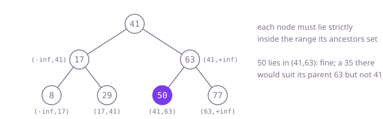

## The question

Given the root of a binary tree, decide whether every node is larger than everything in its left subtree and smaller than everything in its right subtree. Equal values are not allowed anywhere, and values cover the whole `int` range.

What makes it harder than it looks: three classic traps. Comparing each node with its two children is not enough, since Example 2 passes every such check and still hides a 35 on the wrong side of 41. Ranges started at `Integer.MIN_VALUE` and `Integer.MAX_VALUE` reject a tree that really holds those values, as in Example 3. And forgetting that the rule is strict lets duplicates through.

## How to think about it

The first idea is to take the definition literally: at every node, find the largest value in its left subtree and the smallest in its right subtree, and compare. That is correct, but it reads each subtree again for every node above it.

Two observations each fix that. Reading a search tree in order, left subtree, node, right subtree, gives its values sorted; so the tree is valid exactly when the in-order sequence is strictly increasing, which needs only the previous value. Or look at it from the top: each step down narrows the range a node may take. Going left from a node sets a new upper limit, its value; going right sets a new lower limit. So hand each node the open range its ancestors allow and check that it falls inside. The ends of the range are kept as `long`, with the whole `long` range at the root, so that no `int` value can equal them and `Integer.MIN_VALUE` and `Integer.MAX_VALUE` stay legal.

Walk Example 1, `[41,17,63,8,29,50,77]`. 41 gets the whole range. 17 must be below 41, 8 below 17, 29 between 17 and 41; 63 must be above 41, 50 between 41 and 63, 77 above 63. All hold: `true`. In Example 2 the 35 in 50's place gets the range 41 to 63 and is below 41: `false`.



## Brute force

Check the definition at every node: the left subtree's maximum must be below the node and the right subtree's minimum above it. It comes first because it is what you say first, and it fixes the answer to compare against. It is correct because it is the definition, and comparing actual values needs no sentinel, so extreme values are no problem.

```java
static boolean isValidBST(TreeNode root) {
    if (root == null) return true;
    if (root.left != null && max(root.left) >= root.val) return false; // strict: no equal values
    if (root.right != null && min(root.right) <= root.val) return false;
    return isValidBST(root.left) && isValidBST(root.right);
}

private static int max(TreeNode n) {
    int m = n.val;
    if (n.left != null) m = Math.max(m, max(n.left));
    if (n.right != null) m = Math.max(m, max(n.right));
    return m;
}

private static int min(TreeNode n) {
    int m = n.val;
    if (n.left != null) m = Math.min(m, min(n.left));
    if (n.right != null) m = Math.min(m, min(n.right));
    return m;
}
```

**Complexity:** time O(n·h), where h is the depth, since every node's subtree is read once for each node above it; extra space O(h) for the call stack, at most 1,000 frames here.

## Better: an in-order walk that must keep rising

Walk the tree in order with an explicit stack and check that each value is strictly larger than the one before. A flag says whether there is a previous value yet, so no sentinel is needed.

```java
static boolean isValidBST(TreeNode root) {
    ArrayDeque<TreeNode> stack = new ArrayDeque<>();
    boolean seen = false; // no previous value yet: nothing to compare with
    int previous = 0;
    TreeNode node = root;
    while (node != null || !stack.isEmpty()) {
        while (node != null) {
            stack.push(node);
            node = node.left;
        }
        node = stack.pop();
        if (seen && node.val <= previous) return false; // must rise strictly
        seen = true;
        previous = node.val;
        node = node.right;
    }
    return true;
}
```

**Complexity:** time O(n); extra space O(h) for the stack, on the heap, so any depth is fine.

**Prefer it when:** the depth is not capped, or when you need the sorted values anyway, for example to report them or to find the first pair out of order.

## Optimal: hand each node its allowed range

Pass down an open range: the left child gets the node's value as its new upper end, the right child as its new lower end. This is the reference solution.

```java
static boolean isValidBST(TreeNode root) {
    return within(root, Long.MIN_VALUE, Long.MAX_VALUE);
}

private static boolean within(TreeNode node, long low, long high) {
    if (node == null) {
        return true;
    }
    // long bounds: no int value can equal them, so Integer.MIN_VALUE and MAX_VALUE stay legal
    if (node.val <= low || node.val >= high) {
        return false;
    }
    return within(node.left, low, node.val) && within(node.right, node.val, high);
}
```

**Complexity:** time O(n), and it stops at the first node out of range; extra space O(h) for the call stack, where h is the depth; at most 1,000 frames here, but a path of tens of thousands of nodes would overflow Java's default stack.

## Complexity

| Approach | Time | Extra space |
| --- | --- | --- |
| Brute force | O(n·h) | O(h) call stack, at most 1,000 frames here |
| Better: an in-order walk that must keep rising | O(n) | O(h) stack on the heap, any depth |
| Optimal: hand each node its allowed range | O(n) | O(h) call stack, safe for depth up to 1,000, overflows on paths of tens of thousands |

## Where it shows up

No coding-round problem is linked to this question. Checking an ordering invariant over a whole structure is what a database does when it verifies an index after a crash, what a test suite does after every operation on a hand-written balanced tree, and what a validator does for nested numeric ranges such as price bands or IP blocks, where each child range must fall inside its parent's. The trick of passing the allowed range down is the general way to check a constraint that comes from all ancestors at once.

## Follow-up answers

**Why is comparing each node with its two children not enough?** The rule is about whole subtrees: a node must also respect every ancestor it went left or right of. In Example 2, 35 is smaller than its parent 63, which is right for a left child, but it is in the right subtree of 41, so it must be larger than 41 and is not. Only a check that carries information from all ancestors, a range or the in-order sequence, catches it.

**How would the check change if equal values were allowed on the right?** The right subtree may then hold the node's value while the left subtree must stay strictly below it. Every lower end of a range comes from an ancestor the walk went right from, and every upper end from one it went left from, so make the lower end inclusive and keep the upper end exclusive: fail on `node.val < low || node.val >= high`. `[5,null,5]` then passes and `[5,5]` still fails. The in-order check cannot express this rule: "never falls" accepts `[5,5]` too, because the sequence 5, 5 does not say on which side the second 5 hangs.

**How would you find the first node that breaks the rule?** In the range version, return the node that fails the check instead of `false`; with left-before-right recursion that is the first failing node in preorder. If "first" means in sorted order, use the in-order walk and report the node at which the sequence stops rising.
