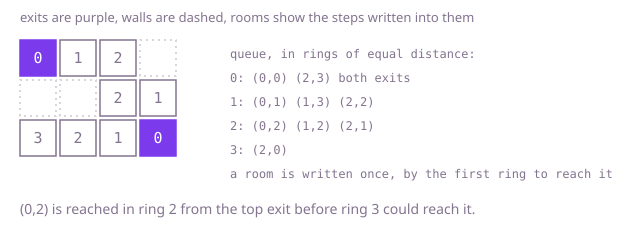

## The question

A floor plan holds walls, exits and open rooms, and every open room must end up holding the fewest steps from it to any exit, moving through side-sharing cells that are not walls. Rooms that cannot reach an exit keep their marker, `Integer.MAX_VALUE`.

What makes it harder than it looks is the size and the marker. A plan of a million cells can be one corridor half a million rooms long, so searching from each room repeats almost the whole corridor for every room. A plan with a quarter of a million exits makes a separate search from each exit just as bad. And the marker is the largest `int`: code that adds one to a room before checking whether it has a distance wraps round to a negative number.

## How to think about it

The first idea is to take each open room in turn and search outwards from it, ring by ring, until a ring holds an exit; the ring number is the answer. It is correct, but neighbouring rooms repeat almost the same search, and along a long corridor that is quadratic.

Turning the search round helps: let each exit reach out and write its distance into the rooms, keeping the smaller value when a room already has one. That shares work between rooms, but every exit can still walk over most of the plan. The fix is to start from every exit at once. A breadth-first search whose queue begins with all the exits reaches rooms in order of their distance to the nearest exit, so the first value written into a room is already the smallest and the room never needs to be touched again. The marker doubles as the visited flag: a room still holding `Integer.MAX_VALUE` has not been reached.

Walk Example 1, `[[0,INF,INF,-1],[-1,-1,INF,INF],[INF,INF,INF,0]]`. The queue starts with both exits, (0,0) and (2,3). The first ring writes 1 into (0,1), (1,3) and (2,2). The second ring writes 2 into (0,2) from the top, and into (1,2) and (2,1) from the bottom. The third ring writes 3 into (2,0). When (1,2) is taken from the queue later, its neighbour (0,2) already holds 2, so it is left alone.



## Brute force

Search from each open room separately, one ring of cells at a time, and stop at the first ring that holds an exit. It comes first because it answers the question exactly as asked, room by room, and it fixes the answer the faster versions must match. It is correct because a breadth-first search meets cells in order of distance, so the first exit it meets is a nearest one. A stamp array, holding the number of the search that last saw each cell, saves clearing a visited grid for every room.

```java
static void fillDistances(int[][] rooms) {
    int height = rooms.length;
    int width = rooms[0].length;
    int[] seen = new int[height * width]; // holds the number of the search that last saw each cell
    int[] queue = new int[height * width];
    int search = 0;
    for (int start = 0; start < height * width; start++) {
        if (rooms[start / width][start % width] != Integer.MAX_VALUE) {
            continue;
        }
        search++;
        int head = 0;
        int tail = 0;
        queue[tail++] = start;
        seen[start] = search;
        int steps = 0;
        boolean found = false;
        while (head < tail && !found) { // one ring of cells per step, until a ring holds an exit
            int end = tail;
            for (; head < end && !found; head++) {
                int r = queue[head] / width;
                int c = queue[head] % width;
                if (rooms[r][c] == 0) {
                    found = true;
                    break;
                }
                int[] near = {r > 0 ? queue[head] - width : -1, r + 1 < height ? queue[head] + width : -1,
                        c > 0 ? queue[head] - 1 : -1, c + 1 < width ? queue[head] + 1 : -1};
                for (int cell : near) {
                    if (cell >= 0 && seen[cell] != search && rooms[cell / width][cell % width] != -1) {
                        seen[cell] = search;
                        queue[tail++] = cell;
                    }
                }
            }
            if (!found) {
                steps++;
            }
        }
        if (found) {
            rooms[start / width][start % width] = steps;
        }
    }
}
```

**Complexity:** time O((R × C)²) for R rows and C columns, since each of up to R × C rooms can search most of the plan, as on a long corridor; extra space O(R × C).

## Better: one search per exit

Let each exit in turn search outwards, writing its distance into every room where it beats the value already there, and going further only from rooms it improved. The first exit fills the plan; later exits only correct the rooms that are closer to them. Rooms nobody reaches keep the marker, and since a room is only queued after it got a distance, the marker is never incremented.

```java
static void fillDistances(int[][] rooms) {
    int height = rooms.length;
    int width = rooms[0].length;
    int[][] steps = {{-1, 0}, {1, 0}, {0, -1}, {0, 1}};
    int[] queue = new int[height * width];
    for (int exit = 0; exit < height * width; exit++) {
        if (rooms[exit / width][exit % width] != 0) {
            continue;
        }
        int head = 0;
        int tail = 0;
        queue[tail++] = exit;
        while (head < tail) {
            int cell = queue[head++];
            int next = rooms[cell / width][cell % width] + 1;
            for (int[] step : steps) {
                int r = cell / width + step[0];
                int c = cell % width + step[1];
                if (r >= 0 && r < height && c >= 0 && c < width && next < rooms[r][c]) {
                    rooms[r][c] = next; // this exit is closer than any found before; walls and exits never pass
                    queue[tail++] = r * width + c;
                }
            }
        }
    }
}
```

**Complexity:** time O(G × R × C) for G exits, since each exit can improve most of the plan; extra space O(R × C) for the queue.

**Prefer it when:** there is a single exit, where it is the same search as the optimal one. With many exits it walks the plan once per exit, and a plan with a quarter of a million exits is far too slow.

## Optimal: breadth-first search from all exits at once

Queue every exit, then take cells from the queue in order and give each open neighbour still holding the marker the current cell's distance plus one, queueing it as it is written. The queue holds cells in rings of equal distance from the nearest exit, so each room's first value is final and every cell is queued at most once. This is the reference solution.

```java
private static final int OPEN = Integer.MAX_VALUE;

static void fillDistances(int[][] rooms) {
    int height = rooms.length;
    int width = rooms[0].length;
    int[] queue = new int[height * width];
    int tail = 0;
    for (int r = 0; r < height; r++) {
        for (int c = 0; c < width; c++) {
            if (rooms[r][c] == 0) {
                queue[tail++] = r * width + c; // every exit starts the search at distance 0
            }
        }
    }
    for (int head = 0; head < tail; head++) {
        int r = queue[head] / width;
        int c = queue[head] % width;
        int next = rooms[r][c] + 1; // never OPEN + 1: only rooms that already have a distance are queued
        if (r > 0) tail = reach(rooms, queue, tail, r - 1, c, next);
        if (r + 1 < height) tail = reach(rooms, queue, tail, r + 1, c, next);
        if (c > 0) tail = reach(rooms, queue, tail, r, c - 1, next);
        if (c + 1 < width) tail = reach(rooms, queue, tail, r, c + 1, next);
    }
}

/** Gives an open room its distance and queues it; returns the new queue length. */
private static int reach(int[][] rooms, int[] queue, int tail, int r, int c, int distance) {
    if (rooms[r][c] == OPEN) {
        rooms[r][c] = distance; // the first exit to arrive is the nearest one
        queue[tail++] = r * rooms[0].length + c;
    }
    return tail;
}
```

**Complexity:** time O(R × C), since every cell is queued at most once and looked at from at most four neighbours; extra space O(R × C) for the queue. Nothing recurses; a recursive search from each exit would go one call deeper per room and overflow the call stack on the half-million-room corridor.

## Complexity

| Approach | Time | Extra space |
| --- | --- | --- |
| Brute force: one search per room | O((R × C)²) | O(R × C) |
| Better: one search per exit | O(G × R × C) | O(R × C) |
| Optimal: breadth-first search from all exits | O(R × C) | O(R × C) |

R and C are the rows and columns and G the number of exits.

## Where it shows up

A breadth-first search seeded with every source at once computes the distance to the nearest source for a whole map in one pass: the distance from each floor tile to the nearest fire exit in an evacuation plan, the "distance field" a game uses to steer enemies towards the player or away from walls, and the distance from each pixel to the nearest edge in image processing.

## Follow-up answers

**Can you do it in time proportional to the size of the plan, however many exits there are?** Yes: start one breadth-first search from all exits together. Each cell is queued at most once, so the cost is O(R × C) whether there is one exit or a quarter of a million.

**How would you also record which exit is nearest to each room?** Keep a second grid, write each exit's own index into it at the start, and when a room is reached copy the index from the cell it was reached from. Ties go to whichever exit's ring arrived first in queue order.

**What if some doors take two steps to pass through instead of one?** Distances are no longer one ring per step, so plain breadth-first search is wrong. With costs of 1 and 2 you can split each slow door into two steps, or use Dijkstra's algorithm with a priority queue seeded with all exits, at O(R × C × log(R × C)).
