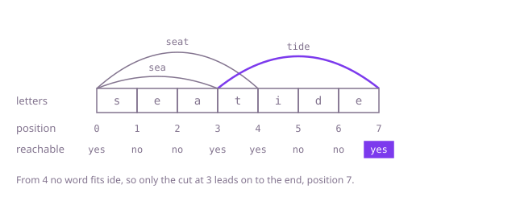

## The question

Given a message with its spaces removed and a list of words, decide whether the message can be cut into pieces that are each one of the words, using any word as often as needed. Every letter must belong to a piece.

What makes it harder than it looks is that no rule for the next piece is safe. Taking the longest word that fits fails Example 1: `seat` leaves `ide`. Taking the shortest fails `cartridge` with `car`, `cart` and `ridge`: `car` leaves `tridge`. So every choice has to be tried, and the number of ways to cut a message grows exponentially with its length: a run of 149 `a`s, with words of one to twenty `a`s, can be cut in about 3.6 × 10^44 ways, and if a single letter after it cannot be covered, a plain search tries them all before it says no. A word can also run past the end of the message, where `text.substring(start, start + word.length())` throws.

## How to think about it

The first idea is a search: try every word that fits at the front, and for each one split the rest the same way. It is correct, but look at what it repeats. Whether the rest can be split depends only on where the rest begins. Cutting `a` + `aa` and `aa` + `a` both leave the rest starting at position 3, and the search works out that rest twice; with many words it works out each rest an exponential number of times.

There are only n + 1 places a rest can begin. Remember for each the answer the first time it is found, failures included, and the search does each position once. Or fill a table from the front: position 0 is reachable, and from every reachable position each word that fits makes the position after it reachable too. The message splits exactly when position n is reachable. Remembering failures matters most: a message that cannot be split is nothing but dead ends, so remembering only the positions that work saves nothing on it.

Walk Example 1, `text = "seatide"`, `words = ["seat", "sea", "tide"]`. Position 0 is reachable. From 0, `seat` fits and reaches 4, `sea` fits and reaches 3. Positions 1 and 2 are not reachable. From 3, `tide` fits and reaches 7, the end. From 4 nothing fits `ide`. Position 7 is reachable, so the answer is `true`.



## Brute force

Try each word as the next piece, split the rest the same way, and succeed as soon as one choice reaches the end. It comes first because it is what you say first, and it fixes the answers to compare against. It is correct because every split starts with some word that fits, so trying each fitting word with every way to split its rest covers every split there is. `startsWith(word, start)` is false, not an exception, when the word runs past the end.

```java
static boolean canSplit(String text, List<String> words) {
    return splitsFrom(text, 0, words);
}

private static boolean splitsFrom(String text, int start, List<String> words) {
    if (start == text.length()) {
        return true; // every letter belongs to a piece
    }
    for (String word : words) {
        // try each word as the next piece, then split the rest the same way
        if (text.startsWith(word, start) && splitsFrom(text, start + word.length(), words)) {
            return true;
        }
    }
    return false;
}
```

**Complexity:** time exponential, up to about 2^(n-1) ways to cut a message of n letters, each step trying all W words of up to L letters; worst on a message that cannot be split. Extra space O(n) for the recursion, at most 300 deep, which fits in the stack.

## Better: memoised search

The same search, with the answer for each starting position stored the first time it is found. Failures are stored as well as successes, so a dead end is never searched twice.

```java
static boolean canSplit(String text, List<String> words) {
    return splitsFrom(text, 0, words, new Boolean[text.length()]);
}

private static boolean splitsFrom(String text, int start, List<String> words, Boolean[] memo) {
    if (start == text.length()) {
        return true;
    }
    if (memo[start] == null) { // null: not worked out yet
        boolean found = false;
        for (String word : words) {
            if (text.startsWith(word, start) && splitsFrom(text, start + word.length(), words, memo)) {
                found = true;
                break;
            }
        }
        memo[start] = found; // false is remembered too: a dead end is searched once
    }
    return memo[start];
}
```

**Complexity:** time O(n × W × L), extra space O(n) for the memo and the recursion, at most 300 deep, which fits in the stack.

**Prefer it when:** a split is likely to turn up early: the search stops at the first split that reaches the end, where the table works through every reachable position.

## Optimal: table of reachable positions

Mark position 0 reachable and walk the positions from the front. From each reachable position, every word that fits there makes the position after it reachable. The message splits when the last position is reachable. This is the reference solution.

```java
static boolean canSplit(String text, List<String> words) {
    int n = text.length();
    boolean[] reachable = new boolean[n + 1]; // reachable[i]: the first i letters split into words
    reachable[0] = true;
    for (int start = 0; start < n; start++) {
        if (!reachable[start]) {
            continue; // no split ends here, so no piece can start here
        }
        for (String word : words) {
            // startsWith is false, not an exception, when the word runs past the end
            if (text.startsWith(word, start)) {
                reachable[start + word.length()] = true;
            }
        }
    }
    return reachable[n];
}
```

**Complexity:** time O(n × W × L) for n letters and W words of up to L letters, extra space O(n).

## Complexity

| Approach | Time | Extra space |
| --- | --- | --- |
| Brute force | exponential, up to about 2^(n-1) cuts | O(n) recursion, at most 300 deep |
| Better: memoised search | O(n × W × L) | O(n), recursion at most 300 deep |
| Optimal: table of reachable positions | O(n × W × L) | O(n) |

## Where it shows up

Languages written without spaces, such as Chinese, Japanese or Thai, are split into words this way before search or translation, with a dictionary and usually a score per word. Splitting a domain name or a hashtag into words, or a run-together product code into the parts of a catalogue, is the same table. Parsers do it too: deciding whether a string can be built from a set of tokens is reachability over positions.

## Follow-up answers

**What if you had to list every way to split the message?** Fill the table from the back instead, saying which positions can reach the end. Then search from the front, but only through positions that can still reach the end, appending each word to the current list. Every branch then ends in a real split, so no work is wasted on dead ends: the cost is the number of pieces in the output times the W × L work of finding each one, and the output itself can be exponential, as for a run of `a`s.

**What if the vocabulary held a million words?** Looping over every word at every position no longer works. Put the words in a hash set and, from each reachable position, try only the pieces up to the longest word's length: O(n × L) set lookups of up to L letters each. Or put them in a trie and walk it along the message from each reachable position, marking a position whenever a word ends: O(n × L) steps, with no substrings built.

**What if you had to use as few words as possible?** Store a count instead of a flag: the fewest words that split the first i letters, with "unreachable" as a marker. From each reachable position, each word that fits offers one more than the current count to the position after it. The answer is the count at position n, at the same O(n × W × L) cost.
