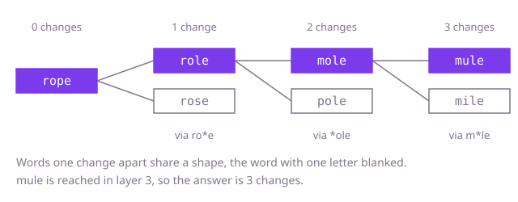

## The question

Given a start word, a target word and a list of allowed words, find the fewest single-letter changes that turn the start into the target, where every word along the way, the target included, is in the list. Return the number of changes, or -1 if no ladder exists.

What makes it harder than it looks is that it is a shortest-path problem in disguise, and the graph is never given: the words are the nodes and nobody tells you which are neighbours. The number counts changes, not words, so a ladder of four words answers 3. And with 50,000 words, deciding neighbours by comparing every pair of words is over a billion comparisons, even before the search starts.

## How to think about it

The first idea is to try ladders: from the start, change one letter to an allowed word, then another, and keep the shortest ladder that reaches the target. That is correct and it explodes, because the same word is reached by countless different routes and every route is explored separately. All that matters about a word is how many changes it took to reach it first. Every change costs the same, so a search that works in rounds, first everything one change away, then everything two changes away, reaches each word by a shortest route the first time it sees it. That is breadth-first search, and it needs a record of the words already reached.

What is left is finding the neighbours of a word. Comparing it with every allowed word works and costs the list size for every word. A faster way: two words are one change apart exactly when blanking the same position in both leaves the same text. `rope` with the third letter blanked is `ro*e`, and so are `role` and `rose`. Group the allowed words by these shapes once, and the neighbours of any word are the members of the groups of its own shapes, found with a few hash lookups.

Walk Example 1, `begin = "rope"`, `end = "mule"`. Layer 0 is `rope`. Its shapes are `*ope`, `r*pe`, `ro*e` and `rop*`, and only `ro*e` has allowed members, `role` and `rose`: layer 1. From `role`, the shape `*ole` holds `mole` and `pole`: layer 2. From `mole`, the shape `m*le` holds `mile` and `mule`. `mule` is the target, reached in layer 3, so the answer is 3. Because layers are explored in order, the first time the target is reached is the shortest ladder.



## Brute force

Try every ladder: from the current word, extend by each unused allowed word that is one change away, and keep the shortest ladder that reaches the target. It comes first because it is the definition of the question, and it fixes the answer faster versions must match. It is correct because it looks at every ladder that never repeats a word, and a shortest ladder never repeats one.

```java
static int fewestChanges(String begin, String end, List<String> allowed) {
    if (begin.equals(end)) {
        return 0;
    }
    int best = extend(begin, end, allowed, new boolean[allowed.size()], 0);
    return best == Integer.MAX_VALUE ? -1 : best;
}

/** Tries every unused allowed word that is one change from word; returns the fewest changes to end. */
private static int extend(String word, String end, List<String> allowed, boolean[] used, int changes) {
    int best = Integer.MAX_VALUE;
    for (int i = 0; i < allowed.size(); i++) {
        String next = allowed.get(i);
        if (used[i] || !oneApart(word, next)) {
            continue;
        }
        if (next.equals(end)) {
            best = Math.min(best, changes + 1);
            continue;
        }
        used[i] = true; // a word may appear once on a ladder
        best = Math.min(best, extend(next, end, allowed, used, changes + 1));
        used[i] = false; // free it for other ladders
    }
    return best;
}

private static boolean oneApart(String a, String b) {
    int differences = 0;
    for (int i = 0; i < a.length(); i++) {
        if (a.charAt(i) != b.charAt(i)) {
            differences++;
        }
    }
    return differences == 1;
}
```

**Complexity:** time exponential in the number of allowed words N, O(N!) in the worst case; extra space O(N), and the recursion can be N deep, so a long ladder overflows the call stack.

## Better: breadth-first search, neighbours by comparing with every word

Search in rounds from `begin`. For each word taken from the queue, compare it with every allowed word that has not been reached yet, and queue the ones that are one change away. Each allowed word is queued at most once, so no route is explored twice, and the round number is the number of changes.

```java
static int fewestChanges(String begin, String end, List<String> allowed) {
    if (begin.equals(end)) {
        return 0;
    }
    int n = allowed.size();
    boolean[] reached = new boolean[n]; // allowed words already queued
    Deque<String> queue = new ArrayDeque<>();
    queue.add(begin);
    int changes = 0;
    while (!queue.isEmpty()) {
        changes++; // everything queued now is one change further than the words in the queue
        for (int level = queue.size(); level > 0; level--) {
            String word = queue.poll();
            for (int j = 0; j < n; j++) { // compare with every allowed word
                if (!reached[j] && oneApart(word, allowed.get(j))) {
                    if (allowed.get(j).equals(end)) {
                        return changes;
                    }
                    reached[j] = true; // claimed when queued
                    queue.add(allowed.get(j));
                }
            }
        }
    }
    return -1;
}

private static boolean oneApart(String a, String b) {
    int differences = 0;
    for (int i = 0; i < a.length(); i++) {
        if (a.charAt(i) != b.charAt(i)) {
            differences++;
        }
    }
    return differences == 1;
}
```

**Complexity:** time O(N² × L) for N allowed words of length L, extra space O(N). It uses no hashing, so this is a true worst case.

**Prefer it when:** the list is small, a few hundred words at most, or you cannot afford the memory for the shape groups. It is the shorter of the two searches, and it needs no hash map.

## Optimal: breadth-first search with shape groups

Build the groups once: for every allowed word and every position, the word with that position replaced by a star maps to the words that have that shape. The search is the same breadth-first search, but a word's neighbours are read from the groups of its own shapes. A word is claimed in a set when it is queued, so it is never queued twice. This is the reference solution.

```java
static int fewestChanges(String begin, String end, List<String> allowed) {
    if (begin.equals(end)) {
        return 0;
    }
    // Words that share a "shape" (one position blanked) are exactly the one-change neighbours.
    Map<String, List<String>> byShape = new HashMap<>();
    for (String word : allowed) {
        for (int i = 0; i < word.length(); i++) {
            byShape.computeIfAbsent(shape(word, i), k -> new ArrayList<>()).add(word);
        }
    }
    Set<String> reached = new HashSet<>(); // claimed when queued
    Deque<String> queue = new ArrayDeque<>();
    Map<String, Integer> changes = new HashMap<>();
    reached.add(begin);
    changes.put(begin, 0);
    queue.add(begin);
    while (!queue.isEmpty()) {
        String word = queue.poll();
        int next = changes.get(word) + 1;
        for (int i = 0; i < word.length(); i++) {
            for (String neighbour : byShape.getOrDefault(shape(word, i), List.of())) {
                if (reached.add(neighbour)) {
                    if (neighbour.equals(end)) {
                        return next;
                    }
                    changes.put(neighbour, next);
                    queue.add(neighbour);
                }
            }
        }
    }
    return -1;
}

private static String shape(String word, int blank) {
    return word.substring(0, blank) + "*" + word.substring(blank + 1);
}
```

**Complexity:** time O(N × L²) on average, O(N × L² × log N) in the worst case, where Java's `HashMap` turns a crowded bucket of `String` keys into a tree; extra space O(N × L²) characters, since each of the N × L shapes is a string of length L. A shape group holds at most 26 words, one per letter at the blanked position, so reading groups adds only a constant factor.

## Complexity

| Approach | Time | Extra space |
| --- | --- | --- |
| Brute force | O(N!) worst case | O(N), and the recursion can overflow the call stack |
| Better: breadth-first, compare with every word | O(N² × L) | O(N) |
| Optimal: breadth-first with shape groups | O(N × L²) average, O(N × L² × log N) worst case | O(N × L²) |

N is the number of allowed words and L the word length, at most 10. Depth-first search stops at the first ladder it finds, which is not the shortest, so it is not a way to speed this up.

## Where it shows up

`friend-suggestion` asks how many steps apart two users are, in `degreesApart`: a breadth-first search over the friend graph with a queue and a visited map that claims a person when they are queued (`steps.putIfAbsent`), and it returns the step count of the first time the target is reached. That is the search here with people for words. The friend graph already lists each person's friends, which plays the role of the shape groups: it is what tells the search the neighbours without comparing every pair. In practice the same search finds the fewest edits to turn one record into another when each edit must give a valid record, the fewest hops through a link graph, and the shortest chain of links between two pages.

## Follow-up answers

**How would you return the whole sequence of words, not just the number of changes?** Store, for each reached word, the word it was reached from. When the target is reached, follow those links back to `begin` and reverse the result. The extra cost is one map entry per word.

**What if the dictionary is huge but you ask many begin and end pairs?** Build the shape groups once and reuse them for every query; only the search is repeated. If the same begin word is asked often, one search from it answers every end word at once.

**How does searching from both ends at once help?** Run a search from `begin` and one from `end`, always expanding the smaller frontier, and stop when they meet. The frontiers grow roughly by the branching factor each round, so two searches of half the depth touch far fewer words than one search of full depth.
