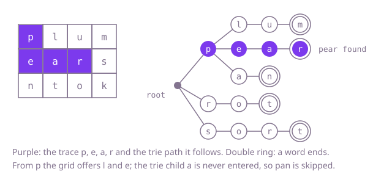

## The question

Given a grid of letters and a list of words, return every word that can be spelled by starting on some cell and stepping up, down, left or right, never visiting a cell twice in one trace. Each word found is listed once, in any order.

What makes it harder than it looks is the size of the list. One Word Search per word is correct, but with thousands of words that begin the same way, every search walks the same paths through the grid again; a grid full of one letter and a list of long words sharing a prefix turns that into minutes. Two smaller traps sit beside it: a word that can be traced from two starts must still be listed once, and the grid has to hold its letters again when the method returns.

## How to think about it

The first idea is to reuse Word Search: for each word, try every start and trace it with marks in the grid, stopping at the first wrong letter. It is correct and it fixes the answer to compare against, but look at what it repeats. Words such as `pear` and `pan` both start by finding every `p` and looking at its neighbours; with 8,000 words that share their first seven letters, the same seven-letter paths are walked 8,000 times.

The work worth sharing is the prefix. If the search walks the grid once and, at each step, asks "is the text of this path the start of any word?", it can stop the moment the answer is no and report a word whenever the path spells one. A set of every prefix of every word answers that question, at the cost of building and hashing a string at each step. A trie answers it without strings: the path's trie node is carried along, and one more letter is one child lookup. A missing child means no word continues, and a node that ends a word means the path spells it.

Walk Example 1 with the trie of `plum`, `rot`, `pear`, `sort` and `pan`. From the `p` in the corner the trie has children l, e and a, but the grid offers only l and e. Down the l branch, `u` and `m` follow and the m node ends `plum`. Down the e branch, `a` and then `r` follow and the r node ends `pear`. The trie child a under p is never entered, because no `a` touches that `p`, so `pan` costs nothing. From the `s`, the trie wants o next, the grid offers m, r and k, and the walk stops at once. From the `r`, o and then t follow, which ends `rot`.



## Brute force

Run the Word Search search once per word: try every start, step only onto the next letter, mark the cells on the trace in the grid and restore them on the way back. It comes first because it reuses a solved problem as it is, and it fixes the answer the faster versions must agree with. It is correct because each word is decided on its own by a complete search.

```java
static List<String> findAll(char[][] board, String[] words) {
    List<String> found = new ArrayList<>();
    for (String word : words) { // one full grid search per word
        if (exists(board, word)) {
            found.add(word);
        }
    }
    return found;
}

private static boolean exists(char[][] board, String word) {
    for (int r = 0; r < board.length; r++) {
        for (int c = 0; c < board[0].length; c++) {
            if (trace(board, word, r, c, 0)) {
                return true;
            }
        }
    }
    return false;
}

// True if word[k..] can be traced starting on cell (r, c).
private static boolean trace(char[][] board, String word, int r, int c, int k) {
    if (r < 0 || c < 0 || r >= board.length || c >= board[0].length || board[r][c] != word.charAt(k)) {
        return false;
    }
    if (k == word.length() - 1) {
        return true;
    }
    char letter = board[r][c];
    board[r][c] = '#';
    boolean found = trace(board, word, r + 1, c, k + 1)
            || trace(board, word, r - 1, c, k + 1)
            || trace(board, word, r, c + 1, k + 1)
            || trace(board, word, r, c - 1, k + 1);
    board[r][c] = letter;
    return found;
}
```

**Complexity:** time O(W · m · n · 3^L) in the worst case for W words of length up to L on an m by n grid (each search can follow up to four first steps and three after that from every start); extra space O(1) beyond a recursion depth of L, at most 10.

## Better: one walk, with a set of prefixes

Put every prefix of every word in a hash set, and the words themselves in another. Walk the grid once from every start, building the path's text; extend the walk only while the text is in the prefix set, and record the text whenever it is a word. A `LinkedHashSet` of results keeps a word traced twice from being listed twice.

```java
static List<String> findAll(char[][] board, String[] words) {
    Set<String> wanted = new HashSet<>(Arrays.asList(words));
    Set<String> prefixes = new HashSet<>();
    for (String word : words) {
        for (int i = 1; i <= word.length(); i++) {
            prefixes.add(word.substring(0, i));
        }
    }
    Set<String> found = new LinkedHashSet<>(); // a word traced twice is kept once
    StringBuilder path = new StringBuilder();
    for (int r = 0; r < board.length; r++) {
        for (int c = 0; c < board[0].length; c++) {
            walk(board, r, c, path, prefixes, wanted, found);
        }
    }
    return new ArrayList<>(found);
}

private static void walk(char[][] board, int r, int c, StringBuilder path,
        Set<String> prefixes, Set<String> wanted, Set<String> found) {
    if (r < 0 || c < 0 || r >= board.length || c >= board[0].length || board[r][c] == '#') {
        return;
    }
    path.append(board[r][c]);
    String text = path.toString();
    if (prefixes.contains(text)) { // some word still starts this way
        if (wanted.contains(text)) {
            found.add(text);
        }
        char letter = board[r][c];
        board[r][c] = '#';
        walk(board, r + 1, c, path, prefixes, wanted, found);
        walk(board, r - 1, c, path, prefixes, wanted, found);
        walk(board, r, c + 1, path, prefixes, wanted, found);
        walk(board, r, c - 1, path, prefixes, wanted, found);
        board[r][c] = letter;
    }
    path.setLength(path.length() - 1);
}
```

**Complexity:** time O(W · L²) on average to build the prefix set, then O(m · n · 3^L · L) on average for the walk, since each step builds and hashes a string of up to L letters; in the worst case each lookup costs O(L log P) for P prefixes, because Java's `HashMap` turns a crowded bucket of `String` keys into a tree; extra space O(W · L²) for the prefixes, plus a recursion depth of L.

**Prefer it when:** you want the single walk without writing a trie, for example in a quick script; it prunes exactly where the trie does. Each step pays for a string and a hash, and the prefix set grows with the square of the word length, so the trie wins on time and memory.

## Optimal: walk the grid and a trie together

Build a trie of the words, with each word stored on the node where it ends. Walk the grid from every start, carrying the trie node of the path so far: a cell whose letter has no child in the current node ends the branch, and a node holding a word adds that word to the answer and clears it, so it is reported once. This is the reference solution.

```java
private static final class Node {
    final Node[] children = new Node[26];
    String word; // the word that ends here, until it is found
}

static List<String> findAll(char[][] board, String[] words) {
    Node root = new Node();
    for (String word : words) {
        Node node = root;
        for (int i = 0; i < word.length(); i++) {
            int slot = word.charAt(i) - 'a';
            if (node.children[slot] == null) {
                node.children[slot] = new Node();
            }
            node = node.children[slot];
        }
        node.word = word;
    }
    List<String> found = new ArrayList<>();
    for (int r = 0; r < board.length; r++) {
        for (int c = 0; c < board[0].length; c++) {
            trace(board, r, c, root, found);
        }
    }
    return found;
}

// Walks the grid and the trie together from cell (r, c); node is the trie node of the letters so far.
private static void trace(char[][] board, int r, int c, Node node, List<String> found) {
    if (r < 0 || c < 0 || r >= board.length || c >= board[0].length || board[r][c] == '#') {
        return; // off the grid or already on this trace
    }
    Node next = node.children[board[r][c] - 'a'];
    if (next == null) {
        return; // no word continues with this letter: the whole branch is dead
    }
    if (next.word != null) {
        found.add(next.word);
        next.word = null; // report each word once, however many traces spell it
    }
    char letter = board[r][c];
    board[r][c] = '#';
    trace(board, r + 1, c, next, found);
    trace(board, r - 1, c, next, found);
    trace(board, r, c + 1, next, found);
    trace(board, r, c - 1, next, found);
    board[r][c] = letter; // restore for the other branches and the caller
}
```

**Complexity:** time O(W · L) to build the trie, then O(m · n · 3^L) in the worst case for the walk, however many words share the paths; extra space O(W · L · 26) in the worst case for the trie nodes, plus a recursion depth of L, at most 10.

## Complexity

| Approach | Time | Extra space |
| --- | --- | --- |
| Brute force: one Word Search per word | O(W · m · n · 3^L) worst case | O(1), recursion depth L |
| Better: one walk with a prefix set | O(W · L²) + O(m · n · 3^L · L) average, a factor log P more in the worst case | O(W · L²), recursion depth L |
| Optimal: one walk with a trie | O(W · L) + O(m · n · 3^L) worst case | O(W · L · 26) worst case, recursion depth L |

W is the number of words, L the longest word length, m by n the grid and P the number of distinct prefixes.

## Where it shows up

No coding-round problem is linked to this question. The same walk scores letter-grid word games against a whole dictionary at once, finds every known term in a block of text with a dictionary trie (the idea behind multi-pattern matchers such as Aho-Corasick), and checks a batch of route codes against a grid of labelled tiles in one pass.

## Follow-up answers

**Why does removing a word from the trie once it is found speed the search up?** Clearing the word only stops it from being reported twice. Going further and deleting trie nodes that no longer lead to any word, on the way back up, means later walks stop earlier: once every word under a prefix is found, that prefix is no longer worth walking at all. On grids where most words are found, that removes most of the remaining work.

**What if the list held a million words but the grid stayed small?** The walk's cost depends on the grid and the word length, not on the number of words, so only building the trie grows. Building it costs time and memory in the total length of the words; a filter first helps, dropping every word that needs a letter, or more copies of a letter, than the grid holds, since such a word can never be traced.

**How would you also return where each word was traced?** Keep the cells of the current path on a stack as the walk goes, pushing a cell when it is marked and popping it when it is restored. When a node holding a word is reached, copy the stack as that word's trace.
