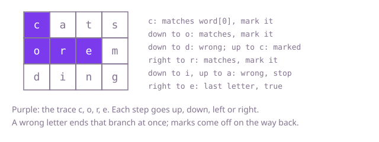

## The question

Given a grid of letters and a word, decide whether the word can be spelled by starting on some cell and stepping up, down, left or right one letter at a time, never visiting a cell twice in one trace.

What makes it harder than it looks is the "never twice" rule together with backing out. A trace has to remember which cells it is standing on, and when a branch fails, those cells must be free again for the next branch; a version that marks cells and forgets to unmark them blocks traces that exist. The other cost is the search itself: the number of paths grows like 3^L for a word of length L, so a search that only checks the letters once a path is complete is far too slow even on an 8 by 8 grid.

## How to think about it

The first idea is to walk every path of L cells from every start and compare its letters with the word once the path is complete. It is correct, since every possible trace is one of those paths, and it fixes the answer to compare against, but it walks every path to the end even when the second letter is already wrong.

The improvement is to compare as you go: step onto a cell only if it holds the next letter of the word, and give up on a branch at the first mismatch. Most branches then die after a step or two. Remembering the cells on the current trace needs a `boolean[][]`, set when you step on and cleared when you step off. The grid can hold that mark itself: overwrite the cell with a character no word contains while the trace stands on it, and write the letter back on the way out. A cheap check first also helps: if the word needs more of some letter than the whole grid holds, no search can succeed.

Walk Example 1, `word = "core"`, trying down, up, right, left in that order. The `c` in the top-left matches, so mark it. Down is `o`, which matches; mark it. From `o`, down is `d` (wrong) and up is the marked `c`, so both stop at once; right is `r`, which matches. From `r`, down is `i` and up is `a`, both wrong; right is `e`, the last letter, so the answer is true.



## Brute force

Walk every path of `word.length()` cells, never revisiting a cell, and compare the letters only when the path is complete. It comes first because it is the definition of a trace written as code, and it fixes the answer the faster versions must agree with. It is correct because every trace of the word is one of the paths it walks.

```java
static boolean exists(char[][] board, String word) {
    boolean[][] used = new boolean[board.length][board[0].length];
    char[] path = new char[word.length()];
    for (int r = 0; r < board.length; r++) {
        for (int c = 0; c < board[0].length; c++) {
            if (walk(board, word, used, path, r, c, 0)) {
                return true;
            }
        }
    }
    return false;
}

// Walks every path of word.length() cells from (r, c) and compares only when the path is complete.
private static boolean walk(char[][] board, String word, boolean[][] used, char[] path, int r, int c, int k) {
    if (r < 0 || c < 0 || r >= board.length || c >= board[0].length || used[r][c]) {
        return false;
    }
    path[k] = board[r][c];
    if (k == word.length() - 1) {
        return new String(path).equals(word);
    }
    used[r][c] = true;
    boolean found = walk(board, word, used, path, r + 1, c, k + 1)
            || walk(board, word, used, path, r - 1, c, k + 1)
            || walk(board, word, used, path, r, c + 1, k + 1)
            || walk(board, word, used, path, r, c - 1, k + 1);
    used[r][c] = false;
    return found;
}
```

**Complexity:** time O(m · n · 3^L · L) for an m by n grid and a word of length L, whichever letters the grid holds (from each start, the first step has up to four choices and every later step up to three, and each complete path costs L to compare); extra space O(m · n) for the marks plus a recursion depth of L, at most 16 here.

## Better: compare as you go, with a separate visited grid

Step onto a cell only when it holds the next letter, so a branch ends at the first mismatch. A `boolean[][]` marks the cells on the current trace and is cleared on the way back.

```java
static boolean exists(char[][] board, String word) {
    boolean[][] onTrace = new boolean[board.length][board[0].length];
    for (int r = 0; r < board.length; r++) {
        for (int c = 0; c < board[0].length; c++) {
            if (trace(board, word, onTrace, r, c, 0)) {
                return true;
            }
        }
    }
    return false;
}

// True if word[k..] can be traced starting on cell (r, c).
private static boolean trace(char[][] board, String word, boolean[][] onTrace, int r, int c, int k) {
    if (r < 0 || c < 0 || r >= board.length || c >= board[0].length
            || onTrace[r][c] || board[r][c] != word.charAt(k)) {
        return false; // a wrong letter ends this branch at once
    }
    if (k == word.length() - 1) {
        return true;
    }
    onTrace[r][c] = true;
    boolean found = trace(board, word, onTrace, r + 1, c, k + 1)
            || trace(board, word, onTrace, r - 1, c, k + 1)
            || trace(board, word, onTrace, r, c + 1, k + 1)
            || trace(board, word, onTrace, r, c - 1, k + 1);
    onTrace[r][c] = false; // free again for the other branches
    return found;
}
```

**Complexity:** time O(m · n · 3^L) in the worst case (a grid where almost every prefix matches, such as all one letter), far less when letters vary; extra space O(m · n) for the marks plus a recursion depth of L.

**Prefer it when:** the grid must not be written to at all, for example when other threads read it during the search.

## Optimal: mark the grid in place, after a letter-count check

Count the letters in the grid first and return false if the word needs more of any letter than the grid has. Then search as above, but mark a cell by overwriting it with `#` and restore its letter on the way back, so no extra grid is needed. This is the reference solution.

```java
static boolean exists(char[][] board, String word) {
    int[] inGrid = new int[26];
    for (char[] row : board) {
        for (char ch : row) {
            inGrid[ch - 'a']++;
        }
    }
    for (int i = 0; i < word.length(); i++) {
        if (--inGrid[word.charAt(i) - 'a'] < 0) {
            return false; // the word needs more of this letter than the grid holds
        }
    }
    for (int r = 0; r < board.length; r++) {
        for (int c = 0; c < board[0].length; c++) {
            if (trace(board, word, r, c, 0)) {
                return true;
            }
        }
    }
    return false;
}

// True if word[k..] can be traced starting on cell (r, c).
private static boolean trace(char[][] board, String word, int r, int c, int k) {
    if (r < 0 || c < 0 || r >= board.length || c >= board[0].length || board[r][c] != word.charAt(k)) {
        return false; // off the grid, already on this trace ('#'), or the wrong letter: stop here
    }
    if (k == word.length() - 1) {
        return true;
    }
    char letter = board[r][c];
    board[r][c] = '#'; // on the trace: no later step may come back here
    boolean found = trace(board, word, r + 1, c, k + 1)
            || trace(board, word, r - 1, c, k + 1)
            || trace(board, word, r, c + 1, k + 1)
            || trace(board, word, r, c - 1, k + 1);
    board[r][c] = letter; // off the trace again, for the other branches and the caller
    return found;
}
```

**Complexity:** time O(m · n + L) for the count, then O(m · n · 3^L) for the search in the worst case, far less when letters vary; extra space O(1) beyond a recursion depth of L, at most 16 here.

## Complexity

| Approach | Time | Extra space |
| --- | --- | --- |
| Brute force: every path, compare at the end | O(m · n · 3^L · L) on every grid | O(m · n), recursion depth L |
| Better: compare as you go, visited grid | O(m · n · 3^L) worst case | O(m · n), recursion depth L |
| Optimal: in-place marks after a count check | O(m · n + L), then O(m · n · 3^L) worst case | O(1), recursion depth L |

## Where it shows up

No coding-round problem is linked to this question. The same search runs in word games that score paths through a letter grid, in puzzle solvers that look for a route through a maze of labelled tiles, and in any depth-first search over a grid where a cell may be entered once per path, such as tracing a cable run through a floor plan without crossing itself.

## Follow-up answers

**How would you cut the search short for a word the grid can never hold?** Count the letters first: if the word needs more of any letter than the grid holds, return false before searching, as the reference does. A second trick is to search from whichever end of the word has the rarer letter, reversing the word if needed, so the first steps already rule out most starts.

**How would you look up many words in the same grid without searching once per word?** Put all the words in a trie and run one search from every cell that walks the grid and the trie together, stopping as soon as the path's letters are not a prefix of any word. Each word found is recorded and can be removed from the trie, so the shared prefixes are explored once instead of once per word.

**What changes if a step may also go diagonally?** Each cell then has up to eight neighbours instead of four, so the search tries eight directions and its worst case grows to O(m · n · 7^L). The marking and the backing out stay the same.
