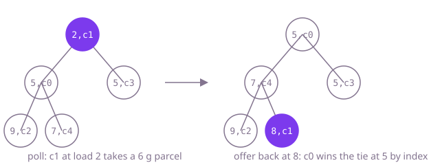

# How a strong round goes: Courier Load Balancer

**Read this first.** This is one good way through the problem, not the only one. The complexity figures describe the reference solution. The DSA reference at the end names the data structure behind the solution, shows it in plain Java, gives its cost and lists the questions to practise, which open inside the app. The prompts are written for interview mode, where the assistant does what you specify and nothing more.

## Minutes 0 to 6: read before you run

Say aloud: "I'll take five minutes to read the planner, the plan and the sample before I run anything."

1. `Parcel` and `Plan`: a parcel is an id and a weight in grams. The plan keeps couriers in list order with their parcels and loads, plus the parcels left over.
2. `LoadBalancer.heaviestFirst`: weight descending, then id. That matches rule 1 of the brief.
3. `LoadBalancer.balance`: for every parcel, a loop over every courier keeps the lightest. Read the comparison in that loop slowly; the brief says ties go to the courier listed first.
4. `data/parcels.csv`: six parcels in kilograms, two of them 3 kg, so ties will matter from the first parcel.
5. `Phase1Tests.java`: five tests; read the names.

Only now run the phase 1 tests.

## Prompt: understand the codebase fast

Use this once, while you read the tests yourself.

```text
Read-only question. For this project give me:
1. One line per class: what it owns and which other classes it calls.
2. For LoadBalancer.balance: how many times the inner loop body runs for n parcels and m couriers.
3. The exact comparison used to pick the lightest courier, with its line number.
Keep it under 150 words. Mark anything you are inferring.
```

Check item 3 against the code yourself. Item 2 is phase 3 in one line.

## Phase 1: the last courier wins ties (minutes 6 to 12)

### Reproduce

Run phase 1 tests. `oneCourierCarriesEverything` and `noParcelsMeansEmptyVans` pass. `tiesGoToTheCourierListedFirst` fails with C getting `p1`, and `heaviestParcelsGoFirst` and `sampleFile` fail the same way: the first parcel goes to the last courier.

### Narrow it down, aloud

"The loads are right; only the names are wrong. At the start every load is zero, so every courier ties. The loop must keep the first of equal couriers, but `<=` lets every later equal courier replace it."

### The cause

`if (load[i] <= load[best])` in the search for the lightest courier.

### The fix

```java
if (load[i] < load[best]) {
```

Run phase 1 tests again; all five pass.

### Say this

"Equal couriers are interchangeable, so the wrong tie-break produces the same set of loads with the names swapped. That is why the totals looked balanced and only the drivers noticed. The cost is n times m comparisons; I'll come back to that."

## Phase 2: van capacity (minutes 12 to 30)

### Analysis before any prompt

- Same order and same choice as `balance`; the only new step is "does it fit".
- "Fits" is `load + weight <= capacity`, at most, so a parcel of exactly the capacity fits.
- A parcel that does not fit on the lightest courier is left over. No other courier is tried, and none could take it: every van is the same size, so the lightest courier has the most room. Say that aloud; it is why the rule is safe.

Work the first test by hand: 8 to A, 7 to B, 5 does not fit on B (12 > 10) and is left over, 3 fits on B (10).

### Decide the approach yourself

"`balance` is `balanceWithCapacity` with no limit. I'll move the loop into one private method that takes a capacity and call it with `Long.MAX_VALUE` from `balance`, so the two can never disagree."

### Prompt

```text
I'd rather not carry two copies of the assignment loop. Pull balance and balanceWithCapacity
onto one private plan method that takes a capacity; balance passes no limit. In plan keep the
strict less-than tie-break on load so the first-listed courier wins, and when the lightest courier
cannot take a parcel, leave it over instead of forcing it on. A capacity of zero or less is an
IllegalArgumentException. Leave the linear search alone for now.
```

### Check the reply for

- The strict `<` kept. A refactor that quietly brings back `<=` fails phase 1 again.
- `>` in the "does not fit" check, so a parcel exactly at capacity fits.
- No loop over other couriers when the lightest one is full.
- Left-overs added in offer order, which is heaviest first.

Run phase 2 tests, then phase 1 again: `withRoomToSpareItMatchesBalance` and phase 1 are your regression suite.

## Phase 3: festival week (minutes 30 to 48)

### Read the tests first

Both tests plan 200,000 parcels for 100,000 couriers in five seconds. Say the cost before changing anything: "Two hundred thousand parcels times a hundred thousand couriers is twenty billion comparisons. The sort is fine; the search for the lightest courier is the problem."

### Decide the approach yourself

"I need the lightest courier quickly and its load changes after every parcel: that is a min-heap. To keep the phase 1 tie-break the heap must order by load, then by the courier's position in the list."

### Prompt

```text
The linear scan for the lightest courier is the n times m part. Replace it with a min-heap keyed
by load and then courier index, so the tie-break survives. A courier's key changes when it takes
a parcel, so it has to leave the heap and come back rather than be changed in place. Nothing
else changes.
```

### Check the reply for

- The index in the comparator. A heap ordered by load alone breaks the tie-break, and phase 1 fails.
- Peek before checking capacity. Polling first and forgetting to put the courier back loses a courier for the rest of the day.
- An `int` load. Loads are sums of grams; keep them `long`.

Run all three phases.

### Reference shape

```java
PriorityQueue<long[]> lightest = new PriorityQueue<>(
        Comparator.<long[]>comparingLong(c -> c[0]).thenComparingLong(c -> c[1]));
for (int i = 0; i < couriers.size(); i++) lightest.add(new long[] {0, i});
for (Parcel parcel : heaviestFirst(parcels)) {
    long[] courier = lightest.peek();
    if (courier[0] + parcel.weightGrams() > capacityGrams) { plan.leaveOver(parcel); continue; }
    lightest.poll();
    courier[0] += parcel.weightGrams();
    plan.give(couriers.get((int) courier[1]), parcel);
    lightest.add(courier);
}
```

## DSA reference

### Theory



**The idea.** "Give each job to the least-loaded worker" is a greedy rule: it makes the locally best choice and never revisits it. Taking the largest jobs first (longest processing time first) keeps the result close to the best possible. The only expensive step is finding the least-loaded worker, and a min-heap does that in O(log m) instead of O(m).

**How to recognise it.** Repeatedly take the smallest (or largest) item, change it, and put it back: task schedulers, meeting rooms, "k closest", merging sorted lists, load balancing.

**The two decisions that cause bugs.** The tie-break: a heap only keeps the order you put in the comparator, so "listed first" must be in the key. And when the key changes, the item must leave the heap and come back; changing it in place corrupts the heap.

**Greedy is not optimal.** Heaviest first on two couriers with weights 3, 3, 2, 2, 2 gives loads 7 and 5, while 3+3 and 2+2+2 gives 6 and 6. Graham's bound says the greedy heaviest load is at most 4/3 of the best possible.

### Code

The structure on its own, outside this codebase; the reference solution is this shape with the problem's names.

```java
/** Heaviest first, each to the lightest worker; the worker listed first wins a tie. */
static long[] loads(long[] weights, int workers) {
    long[] load = new long[workers];
    PriorityQueue<long[]> heap = new PriorityQueue<>(
        Comparator.<long[]>comparingLong(w -> w[0]).thenComparingLong(w -> w[1]));
    for (int i = 0; i < workers; i++) heap.offer(new long[] {0, i});
    long[] sorted = weights.clone();
    Arrays.sort(sorted);
    for (int j = sorted.length - 1; j >= 0; j--) {
        long[] lightest = heap.poll();                 // leave the heap before the key changes
        lightest[0] += sorted[j];
        load[(int) lightest[1]] = lightest[0];
        heap.offer(lightest);                          // come back where the new load belongs
    }
    return load;
}
```

### Complexity

| Approach | Time for n parcels and m couriers | Extra space |
| --- | --- | --- |
| Linear search for the lightest courier | O(n log n + n x m) | O(m) |
| Min-heap keyed by (load, index) | O(n log n + n log m) | O(m) |
| Exact best plan | NP-hard; exponential in general | |

### Practise the technique

These open inside the app under DSA.

- [Task Scheduler](dsa://task-scheduler): greedy choice with a heap of counts.
- [Meeting Rooms III](dsa://meeting-rooms-iii): heaps of free and busy rooms with a lowest-index tie-break, the closest match.
- [Process Tasks Using Servers](dsa://process-tasks-using-servers): servers keyed by weight, then index.

## Time budget

| Minutes | What |
| --- | --- |
| 0 to 6 | Read the planner, the plan, the sample and the test names |
| 6 to 12 | Phase 1: reproduce, name the tie-break, one-character fix |
| 12 to 16 | Phase 2 rule aloud and the first test worked by hand |
| 16 to 30 | Phase 2: shared `plan`, capacity check, phase 1 and 2 runs |
| 30 to 34 | Phase 3: read the tests, say the cost |
| 34 to 48 | Phase 3: the heap, run all three phases |
| 48 to 60 | Read your whole diff, answer the follow-ups aloud |

## Follow-up answers

**Why did the plans look reasonable?** Couriers with equal loads are interchangeable, so the wrong tie-break gives the same multiset of loads with the names swapped. The heaviest load and the spread were right; the drivers noticed only because the last courier always started first.

**When is the greedy plan not the best?** Weights 3, 3, 2, 2, 2 on two couriers: greedy gives 7 and 5, the best is 6 and 6. Heaviest-first greedy is always within 4/3 of the best heaviest load (Graham, 1969).

**Cost.** Before: O(n log n) to sort plus O(n x m) to search, twenty billion steps in phase 3. After: O(n log n + n log m), a few million heap steps.

**Different van sizes.** The lightest courier may not have the most room, so "least loaded" is no longer "most room left". Key the heap by remaining room, largest first, and leave a parcel over only when even the roomiest van cannot take it. Whether that is the right business rule (fill small vans first, or balance by percentage full) is a question to ask, not to assume.

**What the assistant got wrong.** Answer from your own session. Typical: a heap comparator on load alone, polling before the capacity check, trying other couriers when the lightest is full, or `<=` coming back during the refactor.
