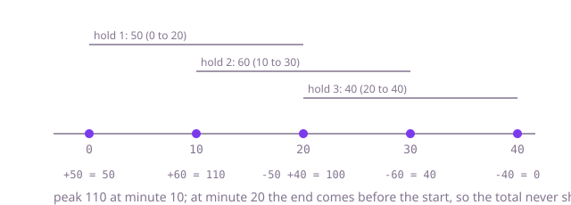

# How a strong round goes: Hold Exposure

**Read this first.** This is one good way through the problem, not the only one. The complexity figures describe the reference solution. The DSA reference at the end names the data structure behind the solution, shows it in plain Java, gives its cost and lists the questions to practise, which open inside the app. The prompts are written for interview mode, where the assistant does what you specify and nothing more.

## Minutes 0 to 6: read before you run

Say aloud: "I'll take five minutes to read the records, the book and the calculator before I run anything."

1. `Hold.java`: a hold has an account, an amount in paise as a `long`, a start minute and an end minute. `activeAt` uses `start <= minute && minute < end`, so the end is exclusive. Say that aloud; it matters in phase 2.
2. `HoldBook.java`: one flat list of every hold plus a set of released ids. Notice that `holdsFor` and `release` both loop over the whole list. You do not need to fix that yet, but note it: "this is linear per call, I'll come back to it if scale matters."
3. `ExposureCalculator.java`: `exposureAt` works, `peak` and `firstBreach` throw, and `peakByAccount` calls `peak` once per account.
4. `Phase1Tests.java`: seven tests. Read the names. Two use very large amounts.
5. `data/holds.csv`: one account, ACME, has amounts a thousand times larger than the others.

Only now run the phase 1 tests.

## Prompt: understand the codebase fast

Use this once, while you read the tests yourself. It asks for facts you can check, not for a diagnosis.

```text
Read-only question. For this project give me:
1. One line per class: what it owns and which other classes it calls.
2. The call path of ExposureCalculator.exposureAt, method by method.
3. The type of every variable that holds a money amount on that path, with the line it is declared on.
4. For each public method of HoldBook: how its cost grows with the number of holds.
Keep it under 200 words. Mark anything you are inferring.
```

Check the answer against the code: open the lines it cites for item 3, and confirm item 4 by looking at the loops in `HoldBook`. Item 3 is the one that pays off in phase 1.

## Phase 1: the negative total (minutes 6 to 12)

### Reproduce

Run phase 1 tests. `sampleFileCorporateAccount` fails at minute 60 with a negative number, and `treasuryAccountWithVeryLargeHolds` fails. The retail test passes. In the corporate test the first two assertions pass and only the third fails.

### Narrow it down, aloud

"Small totals are right and large totals are negative. The failing total is 2,475,000,000. An `int` stops at 2,147,483,647. That is an overflow, so I am looking for an `int` on the path of a `long` amount."

That reasoning takes thirty seconds and needs no assistant. If you want confirmation, ask a specific question:

```text
In ExposureCalculator.exposureAt, what is the declared type of total, what type does hold.amountMinor() return, and what does Java do in "total += hold.amountMinor()" when the types differ?
```

### The cause

`int total = 0;` followed by `total += hold.amountMinor();`. A compound assignment such as `+=` contains a hidden cast, so adding a `long` to an `int` compiles with no warning and silently drops the high bits. Writing `total = total + hold.amountMinor()` would not have compiled.

### The fix

```java
long total = 0;
```

One word. Run phase 1 tests again; all seven pass.

### Say this

"The bug was a narrowing compound assignment. Cost of `exposureAt` is linear in the holds of the account, but `holdsFor` scans the whole book, so it is linear in all holds. I'll leave that for now."

## Phase 2: peak and first breach (minutes 12 to 35)

### Analysis before any prompt

Write three lines in a comment or say them aloud:

- The total only changes at a hold's start or end. So the answer is determined by those moments, not by every minute.
- Ends are exclusive. A hold ending at 10 and one starting at 10 must not be counted together.
- "Earliest minute of the peak" means a later equal total must not replace an earlier one.

### Decide the approach yourself

"I'll turn each hold into two events, plus the amount at the start and minus the amount at the end, sort them by minute with ends before starts inside the same minute, and walk through them keeping a running total. The peak is the highest running total; the first breach is the first time it exceeds the limit."

### Prompt

Ask for exactly that, one method at a time:

```text
I'm going to sweep over the hold endpoints. Give me a private events(account) that turns the
account's holds into sorted (minute, delta) pairs: plus the amount at the start, minus it at the
end, and for equal minutes the minus first, because a hold is no longer active at its end minute.
Use book.holdsFor(account). Only this method.
```

Then:

```text
With events in place, implement peak(account) as one walk with a running total, taking the
highest total and the earliest minute it was reached, Peak.NONE when there are no holds. Then
firstBreach(account, limitMinor) with the same walk: the minute of the first event after which the
total exceeds the limit, empty otherwise; a negative limit is an IllegalArgumentException.
```

### Check the reply for

- The sort order at equal minutes. Starts before ends fails `holdsThatOnlyTouchDoNotOverlap` and `aHoldEndingAsAnotherStartsDoesNotBreach`.
- `>` and not `>=` when updating the best total.
- A `long` running total. The phase 1 mistake is easy to repeat.
- Released holds: they are already filtered by `holdsFor`, so no extra code should appear.

Run phase 2 tests after each method, not after both.

### Reference shape

```java
private record Event(int minute, long delta) {}

public Peak peak(String account) {
    long running = 0, best = 0;
    int bestMinute = -1;
    for (Event e : events(account)) {
        running += e.delta();
        if (running > best) { best = running; bestMinute = e.minute(); }
    }
    return bestMinute < 0 ? Peak.NONE : new Peak(best, bestMinute);
}
```

## Phase 3: busy books (minutes 35 to 52)

### Read the two tests first

Say what each one stresses before changing anything:

- `oneBusyAccount`: one account, 120,000 holds. This stresses `peak` itself. A version that recomputes the total at every hold start is quadratic and times out. The sweep from phase 2 already passes.
- `manySmallAccounts`: 40,000 accounts with 5 holds each, 10,000 releases, then `peakByAccount`. Each `peak` is tiny. The cost is in `HoldBook`: `holdsFor` scans all 200,000 holds for each of 40,000 accounts, and `release` scans the list for each id.

If you run phase 3 and only the second test times out, that confirms it: the calculator is fine and the book is slow.

### Prompt

```text
Every HoldBook method scans the whole book. I want holds indexed by account and by id so nothing
scans: a map from account to its holds in insertion order, and a map from id to hold. Keep the
public methods and their exact behaviour, including accounts() still listing an account that has
released everything. Only this class.
```

### Check the reply for

- `accounts()` must still include an account whose holds were all released. The test expects exactly 40,000 accounts.
- `release` must return `false` for an unknown id.
- `holdsFor` on an unknown account returns an empty list, not `null`.

Run phase 1, 2 and 3 tests. Phase 1 and 2 are your regression suite for the rewrite.

## DSA reference

### Theory



**The idea.** When a quantity changes only at the start and end of intervals, you do not need to look at every moment or compare every pair of intervals. Put every start and every end on one time line, sort them, and walk left to right while keeping a running value. This is called a sweep line, or a line sweep.

**How to recognise it.** The question mentions overlapping intervals and asks for a maximum, a count at the busiest moment, or the first time a threshold is crossed: meeting rooms needed, peak concurrent users, maximum load, calendar conflicts.

**The two decisions that cause bugs.** First, what happens when an end and a start share the same time: if the end is exclusive, process ends first; if inclusive, starts first. Second, whether ties keep the earliest or the latest answer.

**An alternative.** When times are small integers in a known range, a difference array does the same job without sorting: add at the start index, subtract at the end index, then take a running sum. Here minutes go up to about a million, so sorting the events is the safer default.

### Code

The structure on its own, outside this codebase; the reference solution is this shape with the problem's names.

```java
/** Highest number of intervals active at once; ends before starts at the same time (end is exclusive). */
static int peakOverlap(List<int[]> intervals) {
    long[] events = new long[intervals.size() * 2];     // minute * 2 + (0 for end, 1 for start)
    int n = 0;
    for (int[] iv : intervals) {
        events[n++] = (long) iv[0] * 2 + 1;               // start
        events[n++] = (long) iv[1] * 2;                   // end sorts first at the same minute
    }
    Arrays.sort(events);
    int active = 0, peak = 0;
    for (long e : events) {
        active += (e & 1) == 1 ? 1 : -1;
        peak = Math.max(peak, active);
    }
    return peak;
}
```

### Complexity

| Approach | Time for one account with n holds | Extra space |
| --- | --- | --- |
| Total at every hold start (compare all pairs) | O(n squared) | O(1) |
| Sweep over sorted events | O(n log n) | O(n) |
| Difference array over T possible minutes | O(n + T) | O(T) |

| Operation in `HoldBook` | Starter | Indexed by account and id |
| --- | --- | --- |
| `holdsFor(account)` | O(all holds) | O(1) to find the list |
| `release(id)` | O(all holds) | O(1) to find, O(k) to remove from an account with k holds |
| `peakByAccount()` with A accounts, N holds | O(A x N) | O(N log N) worst case |

### Practise the technique

These open inside the app under DSA.

- [Meeting Rooms II](dsa://meeting-rooms-ii): the minimum number of rooms is the peak number of overlapping intervals. The closest match to this problem.
- [Car Pooling](dsa://car-pooling): a running total over start and end points with a capacity limit, which is `firstBreach`.
- [Merge Intervals](dsa://merge-intervals): sorting intervals and reasoning about touching ends.

## Time budget

| Minutes | What |
| --- | --- |
| 0 to 6 | Read the five source files, the phase 1 test names and the CSV |
| 6 to 12 | Phase 1: reproduce, reason to overflow, one-word fix, re-run |
| 12 to 16 | Phase 2 analysis aloud: events, exclusive end, earliest tie |
| 16 to 35 | Phase 2: `events`, then `peak`, then `firstBreach`, a test run after each |
| 35 to 40 | Phase 3: read both tests, name what each stresses, run |
| 40 to 52 | Phase 3: index `HoldBook`, re-run all three phases |
| 52 to 60 | Read your whole diff, tidy names, say what you would do next |

## Follow-up answers

**Why did the original code compile without a warning?** `a += b` means `a = (T) (a + b)` where `T` is the type of `a`. The cast is part of the language rule, so narrowing a `long` into an `int` is silent.

**Touching holds.** Events are sorted by minute and, inside one minute, the negative delta comes first. At minute 10 the running total drops before it rises, so it never holds both amounts.

**Cost.** `peak` is O(n log n) for an account with n holds because of the sort. `peakByAccount` is the sum of that over all accounts once `holdsFor` no longer scans the book, so O(N log N) in the worst case for N holds.

**Concurrent use.** `HoldBook` is plain collections with no synchronisation. Options: guard it with a read-write lock, since reads far outnumber writes; or make each account's list immutable and replace it on change so readers never see a half-updated list. A peak computed while holds change is a snapshot either way; say what consistency the risk team needs.

**What the assistant got wrong.** Answer from your own session. Typical: starts sorted before ends, `>=` on the best total, an `int` running total, or an `accounts()` that forgets fully released accounts.
