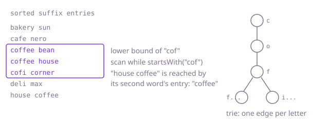

# How a strong round goes: Merchant Suggest

**Read this first.** This is one good way through the problem, not the only one. The complexity figures describe the reference solution. The DSA reference at the end names the data structure behind the solution, shows it in plain Java, gives its cost and lists the questions to practise, which open inside the app. The prompts are written for interview mode, where the assistant does what you specify and nothing more.

## Minutes 0 to 7: read before you run

1. `Normalizer.java`: lower case, anything that is not a letter or digit becomes a space, spaces collapse. Read the example in the comment: "Domino's Pizza!" becomes "domino s pizza". The apostrophe makes a one-letter word. Remember it.
2. `MerchantDirectory.java`: two parallel lists, `keys` and `merchants`, kept sorted by normalized name. `add` uses `Collections.binarySearch` and inserts in the middle of both lists. `find` has its own hand-written binary search. Two different searches in one class is worth saying aloud.
3. `Suggester.java`: one method that throws.
4. `data/merchants.txt`: 19 merchants.
5. Run `Main`. `amazon pay` and `zomato` are not found; `BIG BAZAAR`, `Cafe Coffee Day` and `Swiggy` are. Case is clearly not the problem, because the upper-case lookup works.

## Prompt: understand the codebase fast

```text
Read-only question. For this project give me:
1. One line per class: what it owns and which other classes it calls.
2. In MerchantDirectory: what stays true about the lists keys and merchants after every add.
3. In MerchantDirectory.find: the initial values of low and high, whether high is inclusive or exclusive, the loop condition, and how low and high are updated.
4. The cost of add and of find as the directory grows to n merchants.
Keep it under 200 words. Mark anything you are inferring.
```

Item 3 asks for facts, not a verdict, so an assistant in interview mode will answer it. Read the four facts side by side and the mismatch is visible. Item 4 sets up phase 3.

## Phase 1: merchants that cannot be found (minutes 7 to 15)

### Reproduce

Run phase 1 tests. `findsTheOnlyMerchant` fails: a directory with one merchant cannot find it. `findsEveryMerchantInTheSampleFile` lists eight merchants that are missed.

### Use the smallest failing case

"One merchant. `low` is 0 and `high` is `size - 1`, so `high` is 0 too. The loop runs `while (low < high)`. Zero is not less than zero, so the loop never runs and the method returns empty without looking at anything."

### The cause

`high` starts at `size - 1` and moves to `middle - 1`, so it is an inclusive bound. With an inclusive bound, one candidate remains when `low == high`, and the loop must still test it: the condition has to be `low <= high`. With `<`, every search that narrows down to a single position stops one step early. Whether a merchant is hit depends on its position, which is why only some names fail.

### The fix

```java
while (low <= high) {
```

Or delete the hand-written loop and reuse what `add` already uses:

```java
int position = Collections.binarySearch(keys, key);
return position >= 0 ? Optional.of(merchants.get(position)) : Optional.empty();
```

The second is the better answer in an interview: less code, one search instead of two, and you can say why.

### Say this

"Inclusive upper bound with a strict loop condition. I checked the one-element case by hand. A lookup is O(log n)."

## Phase 2: suggestions (minutes 15 to 38)

### Analysis before any prompt

Restate the rules as cases, aloud, using the brief's example:

- "coffee d" must match "Cafe Coffee Day": the typed text has to match from the start of a word and continue across the space.
- "offee" must not match: only word starts count.
- "s" matches "Domino's Pizza", because the normalized name is "domino s pizza".
- Ties on count are ordered by the normalized name, not the display name.
- A name with the same word twice appears once.
- Suggestions follow later changes to the directory. Any index or cache I add later has to respect this.

### Decide the approach yourself

"First a direct version: normalize the typed text; for every merchant, normalize the name and test `key.startsWith(prefix) || key.contains(\" \" + prefix)`; sort the matches by count descending, then key; cut to the limit. It is linear per call, which I'll revisit in phase 3."

The `contains(" " + prefix)` test is the whole word-start rule in one expression, and it handles multi-word typed text for free.

### Prompt

```text
First the direct version of Suggester.suggest(typed, limit): normalise the typed text, match
merchants whose normalised name starts with it or has a word that starts with it, rank by
transaction count then name, and return at most limit. A limit outside 1 to 10 is an
IllegalArgumentException and an empty prefix returns nothing. Read directory.all() on each call,
no caching yet. Only this method.
```

### Check the reply for

- Sorting ties by `merchant.name()` instead of the normalized key.
- Matching inside words (`contains(prefix)` without the leading space).
- Duplicates: with this expression a merchant is tested once, so none can appear. A trie-based reply needs explicit de-duplication.
- A cached list of merchants in a field, which breaks `suggestionsFollowChangesToTheDirectory`.

## Phase 3: every keystroke (minutes 38 to 57)

### Read the three tests first

Each is slow for a different reason. Name all three before changing anything.

- `loadingTheNightlyFeed`: 800,000 calls to `add`, in the partner's Z-to-A order. No suggestions at all. `add` inserts into two sorted array lists; because the feed arrives in reverse order, every merchant goes to the front and shifts the whole list: the load is quadratic. **This is in code you did not write.**
- `specificSearches`: 20,000 searches on 100,000 merchants. The direct version normalizes and tests every merchant on every call.
- `typingLetterByLetter`: 30,000 words typed one letter at a time. One- and two-letter prefixes match tens of thousands of merchants, and the same short prefixes are asked thousands of times.

### Fix 1: the directory

```text
MerchantDirectory keeps a sorted array list and shifts on every add. Move it to a TreeMap keyed
by normalised name so add is a put and find is a get, keep all() as an unmodifiable snapshot in
key order rebuilt only after a change, and add a version counter that grows on every add so a
caller can tell when the data moved. Keep the other public methods as they are.
```

`version()` is the change signal the next two fixes need. Checking `size()` is not enough: replacing a merchant keeps the size the same.

### Fix 2: an index for prefixes

"For every merchant I add one entry per word: the rest of the normalized name from that word on, with the merchant. 'cafe coffee day' gives 'cafe coffee day', 'coffee day' and 'day'. Sorted, all entries that start with the typed text sit next to each other, so I find the first one by binary search and read forward while entries still start with the prefix."

```text
Now the index. For every merchant, one entry per word start of its normalised name: the suffix
from that word onward plus the merchant; sort the entries by text. Build it lazily and rebuild only
when the directory's version has changed. suggest then binary-searches to the first entry at or
after the prefix, scans forward while entries still start with it, skips a merchant it already
counted, and keeps the best ten by transaction count then name before cutting to limit.
```

### Fix 3: remember answers for repeated prefixes

```text
The same prefix gets typed over and over, so remember the best-ten list per normalised prefix and
throw that memory away whenever the index is rebuilt. suggest answers from it when it is there.
```

A trie that stores the ten best merchants at every node does fixes 2 and 3 in one structure. Say that you know it and why you chose the sorted array: less code to get right in the time left, and far fewer objects for 100,000 names.

### Check the reply for

- An index over whole names only, which misses later words.
- Rebuilding the index on every call.
- A remembered-answers map that is never cleared. The phase 2 test on directory changes is your guard; run phase 2 again.
- Using `size()` instead of `version()` as the change signal.

## DSA reference

### Theory



**Binary search bounds.** Pick one convention and keep every line consistent with it. Inclusive: `high = n - 1`, loop `while (low <= high)`, shrink with `high = middle - 1`. Exclusive: `high = n`, loop `while (low < high)`, shrink with `high = middle`. Mixing a line from each is the classic bug, and the one-element input exposes it.

**Prefixes in sorted data.** In a sorted list of strings, every string that starts with a given prefix forms one contiguous block. Binary search finds the start of the block in O(log n); reading the block costs its length. To match at word starts, index every word-start suffix of each name.

**Trie.** A tree with one edge per character; every node stands for a prefix. Walking the typed text costs its length, independent of how many names exist. Storing the best k results at each node makes a suggestion a walk plus a copy. It costs memory: one node per distinct prefix.

**Remembering answers.** When the same question is asked repeatedly and the data changes rarely, keep the answer and discard it on change. The hard part is always the "discard on change".

### Code

The structure on its own, outside this codebase; the reference solution is this shape with the problem's names.

```java
/** All strings in a sorted list that start with prefix: one binary search, then a scan of the block. */
static List<String> withPrefix(List<String> sorted, String prefix) {
    int low = 0, high = sorted.size();                 // exclusive high: first index >= prefix
    while (low < high) {
        int mid = (low + high) >>> 1;
        if (sorted.get(mid).compareTo(prefix) < 0) low = mid + 1; else high = mid;
    }
    List<String> block = new ArrayList<>();
    for (int i = low; i < sorted.size() && sorted.get(i).startsWith(prefix); i++) {
        block.add(sorted.get(i));
    }
    return block;
}
```

### Complexity

| Operation | Starter or direct version | Reference |
| --- | --- | --- |
| `add` one merchant, n in the directory | O(n) shifting in an array list | O(log n) in a sorted map |
| Load n merchants | O(n squared) | O(n log n) |
| `find` | O(log n) | O(log n) |
| `suggest`, direct scan | O(n x name length) per call | not used |
| Build the suffix index, n names of w words | not used | O(n w log(n w)) time, O(n w) space |
| `suggest` with the index, m matching entries | not used | O(log(n w) + m) first time, O(1) when remembered |
| Trie with best k per node (alternative) | not used | O(typed length + k) per call, O(total characters) space |

### Practise the technique

These open inside the app under DSA.

- [Implement Trie (Prefix Tree)](dsa://implement-trie-prefix-tree): the structure itself.
- [Search Suggestions System](dsa://search-suggestions-system): suggestions after every typed letter, solved with sorting plus binary search and with a trie. The closest match to phase 3.

## Time budget

| Minutes | What |
| --- | --- |
| 0 to 7 | Read `Normalizer`, `MerchantDirectory`, the data file; run `Main` |
| 7 to 15 | Phase 1: one-element case by hand, fix the loop or reuse `binarySearch` |
| 15 to 20 | Phase 2: restate the rules as cases, choose the direct version |
| 20 to 38 | Phase 2: implement, check tie-break and word starts, run |
| 38 to 43 | Phase 3: read the three tests, name the three causes, run |
| 43 to 57 | Phase 3: sorted map and version, suffix index, remembered answers; re-run phase 2 each time |
| 57 to 60 | Say what you did not finish and what you would do next |

Phase 3 is deliberately too much for many candidates in the time. Naming all three causes and fixing one or two is a good result.

## Follow-up answers

**Cost of suggest and of the index.** Building: one entry per word of every name, sorted, so O(n w log(n w)) time and O(n w) space for n names of w words. A suggestion: O(log(n w)) to find the block plus the block length the first time; constant when the prefix was asked before.

**The three reasons phase 3 was slow.** Quadratic loading from array-list insertion, fixed with a sorted map; a full scan per search, fixed with a sorted index of word-start suffixes; huge repeated result sets for short prefixes, fixed by remembering the best ten per prefix.

**When remembered answers are dropped.** When the directory's version changes. If they were not, a customer would keep seeing old counts and miss new merchants until the next restart.

**Changes all day, not only at night.** Rebuilding everything on each change is too slow at that rate. Options: batch changes and rebuild on a timer, accepting a few seconds of staleness; keep a small unsorted list of recent changes that is checked alongside the main index and merged periodically; or use a trie, which can be updated one name at a time.

**What the assistant got wrong.** Answer from your own session. Typical: tie-break on the display name, an index of whole names only, a cache that is never cleared, or `size()` as the change signal.
